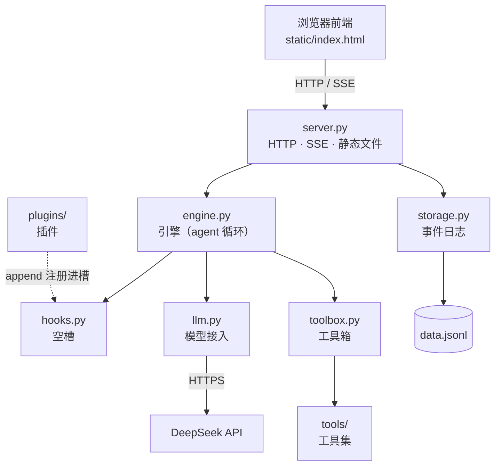
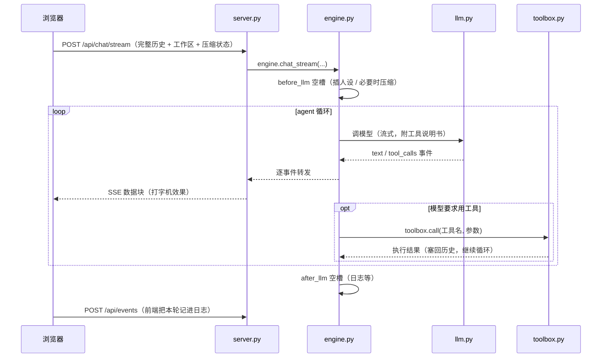

# 架构总览

| 状态 | 最后更新 | 关联代码 | 代码基线 |
|---|---|---|---|
| Stable | 2026-10-16 | 全部模块 | `5a774e1` |

> 这是整套文档的**总纲**：先读懂全局（模块怎么分、机制怎么转），
> 再按需要跳到各模块文档看细节。细节永远不在本文重复写——只放链接。

---

## 1. 项目定位

**一个零框架、零第三方依赖的极简 Agent**——纯 Python 标准库 +
原生 HTML/JS，把"现代 AI Agent 的核心机制"用能读懂的最小实现做出来。

贯穿全部代码的四条设计约束（理解任何一处代码前先记住它们）：

| 约束 | 含义 | 为什么 |
|---|---|---|
| 不用框架、零依赖 | 运行时不装任何第三方包 | 教学第一：所有机制都看得见源码；部署零门槛 |
| 主流程要"薄" | 功能通过"空槽 + 插件""文件即工具"插入 | 核心稳定，扩展不动主干 |
| 数据只追加 | 事件日志只往后加行，从不重写 | 写入快、不怕写坏、历史完整可追溯 |
| 单机本地运行 | 只监听 `127.0.0.1`，不上云 | 安全，且是"个人工具"的合理形态 |

---

## 2. 系统全貌



几个要点（对照上图）：

- **浏览器不直接接触模型**——所有请求经过 `server.py`；API Key 只存在于后端。
- **engine 是唯一的中枢**：它调模型（llm）、执行工具（toolbox）、路过空槽（hooks）。
- **插件不是调用关系，是"注册关系"**：插件把函数 `append` 进空槽，
  由引擎在固定时机执行（虚线箭头表示"注册进"）。
- **storage 只被 server 使用**：前端通过 HTTP 接口记账 / 读状态，后端负责文件读写。

---

## 3. 模块一览

| 模块 | 文件 | 一句话职责 | 模块文档 |
|---|---|---|---|
| 启动入口 | `server.py` | HTTP 服务：路由、SSE 流式、静态文件、工作区对话框 | 规划中 |
| 引擎 | `engine.py` | agent 循环：串起"调模型 ⇄ 执行工具"，转发事件流 | [modules/engine](modules/engine/README.md) |
| 模型接入 | `llm.py` | 和 DeepSeek 说话：流式解析、工具调用协议 | [modules/llm](modules/llm/README.md) |
| 工具箱 | `toolbox.py` | 工具注册表 + 调度 + 工作区管理 + 禁用名单 + 附件槽 | [modules/toolbox](modules/toolbox/README.md) |
| 工具集 | `tools/` | 文件即工具：list_dir / read_file / write_file / edit_file / exec_command / spawn_agent | [modules/tools](modules/tools/README.md) |
| 插件 | `plugins/` | 挂在空槽上的功能：system_prompt / compact / logger | [modules/plugins](modules/plugins/README.md) |
| 空槽 | `hooks.py` | 三个函数列表 + 调度器（整个扩展机制的地基） | [modules/plugins](modules/plugins/README.md)（§2） |
| 存储 | `storage.py` | 事件日志：追加事件 + 回放推导状态 | [modules/storage](modules/storage/README.md) |
| 链路观测 | `tracing.py` | 每次任务的完整执行链路（上下文快照 / 思考 / 工具 / 耗时） | [modules/tracing](modules/tracing/README.md) |
| 配置 | `config.py` | 全部可调参数（Key / 模型 / 阈值 / 开关） | 规划中 |
| 前端 | `static/index.html` | 单页应用：状态驱动渲染、流式打字机、全部界面逻辑 | 规划中 |

---

## 4. 核心机制

七个机制构成系统全部"有意思的部分"。每个先给一段话，细节链到模块文档。

### 4.1 空槽 + 插件（扩展机制的地基）

`hooks.py` 里目前有三个**空槽**（普通列表）：`before_llm`（调模型前）、
`after_llm`（模型回答后）、`before_tool`（执行工具前）。
插件文件里的函数 `append` 进去，引擎在固定时机依次执行。

- 插件的约定：函数接收 `ctx`（共享数据袋），**原地修改**它（如改 `ctx["messages"]`）；
  `before_tool` 槽里把 `ctx["blocked"]` 设为字符串 = 拦截这次工具调用。
- 加功能 = 往 `plugins/` 扔一个文件，主流程一行不改（`engine.load_plugins()` 自动加载）。
- 已投产的插件：`system_prompt`（插入人设）、`compact`（上下文压缩）、`logger`（日志）。
- 想加"新时机"？在 `hooks.py` 里再加一个列表即可（注释里留了示例位置）。

### 4.2 事件日志 + 回放（数据的地基）

所有数据存在 `data.jsonl`：**每行一条 JSON 事件**（append-only）。
前端每个动作（发消息、改名、删会话、工具调用……）都被翻译成事件追加进日志；
需要数据时，`storage.py` 把日志从头**回放**一遍，推导出当前状态。

- 事件类型（8 种）：`session` / `message` / `tool` / `workspace` / `compact` / `rename` / `delete` / `switch`。
- 删除是"逻辑删除"：日志里的旧行不动，只是回放时忽略。
- 未知事件类型直接跳过——**天然向前兼容**（旧代码读新日志不会崩）。
- 详细字段表见 [modules/storage](modules/storage/README.md)（§4.2）；
  独立的事件字典 `data/event-log.md` 规划中。

### 4.3 Agent 循环（心脏）

引擎的核心是"多轮干活"的循环，`engine.chat_stream()` 是它的流式实现：

```
调模型（流式）──► 模型直接回答？ → 结束
      │
      └─► 模型要求用工具 → 执行工具 → 结果塞回历史 → 再调模型 → …
```

- 保险丝：连续工具轮数超过 `MAX_TOOL_ROUNDS`（config）就停，防死循环烧钱。
- 流式产出的事件（路由到前端）：`text` / `tool_call` / `tool_result` / `compacted`。
- 历史里的工具记录发给模型前会转成标准协议对（`assistant(tool_calls)` + `tool`），
  这样模型"记得"自己读过什么（细节见 [modules/engine](modules/engine/README.md) §4.4）。

### 4.4 工具体系（手脚）

工具 = **说明书（DESCRIPTION）+ 执行函数（run）**，登记在 `toolbox.py` 的注册表里；
`tools/` 目录自动加载——**文件即工具**。


- 说明书在 `all_descriptions()` 里从"内部格式"包装成 API 要求的格式——
  这一层也是将来接 MCP / Skill 工具的适配点（`register(..., source=...)` 已预留）。
- **禁用名单**：线程级的 `set_disabled()` 可临时禁掉某些工具
  （`all_descriptions` 过滤 + `call` 拦截两道门）——子代理防套娃就靠它。
- **附件槽**：工具的 `run` 里调 `attach(data)` 可捎带结构化数据（如子代理完整过程），
  引擎取走（`take_attachments()`）后随 `tool_result` 事件流向前端和日志。

### 4.5 工作区沙箱（安全边界）

每个会话有一个**工作区**。新对话由前端**自动分配** `sandbox/<时间戳>`
（如 `sandbox/2026-10-16-20-56`）作为默认；也可手动切换为任意安全目录（含"项目目录"）：

- 所有文件工具的路径都被 `safe_path()` 锁在工作区内（`../` 越界直接拦）；
- **例外：`exec_command`**——命令是任意程序，工作区只是它的默认执行目录，
  路径锁管不到命令内部（危险命令有黑名单兜底：防手滑、不防刻意）；
- 盘根、用户主目录、系统目录被拒绝；纯名字自动建到 `sandbox/<名字>`；
- **安全红线：只有用户可以设置工作区，模型无权修改**（它没有对应工具）；
- 会话级绑定，通过 `threading.local` 在多线程服务器里防串台。

### 4.6 上下文压缩（窗口管理）

用量估算超窗口的 70%（`COMPACT_THRESHOLD_RATIO`）时，`compact` 插件
在 `before_llm` 槽里把**早期对话交给模型总结成摘要**，之后发给模型的是
「人设 + 摘要 + 最近 `KEEP_RECENT_MESSAGES` 条」。

- **覆盖式全量摘要**：再次压缩时输入 = 旧摘要 + 新增被吸收段，不套娃；
- 原始消息一条不删（都在日志里），压缩只是一条 `compact` 事件；
- 前端有用量计量条（含阈值刻度）和手动压缩入口；压缩发生时会显示压缩卡片。

### 4.7 子代理（多 agent 的第一块积木）

主 agent 通过 `spawn_agent` 工具派出**子代理**：它有独立上下文、能自己调用工具、
干完只把一份精炼结论带回主对话。

- 实现上**不造新引擎**——`spawn_agent.run()` 直接整段消费 `engine.chat_stream()`；
- 子代理干活期间禁用 `spawn_agent` 自己（防无限套娃）；
- 自动继承当前工作区；**完整过程**（任务 → 每次工具调用 → 结论）随 `extra`
  进入事件日志，前端工具卡片里可「展开子代理过程」查看，刷新后仍在。

---

## 5. 关键流程：一次流式对话的完整旅程



配套要点：

- **记账在前端发起**：前端收到完整事件流后，一次性把
  用户消息 / 助手文字段 / 工具记录翻译成事件批量提交——好处是
  前端所见与日志内容天然一致（所见即所记）。
- **发送的是完整时间线**：历史里的工具记录照发，后端先按压缩状态切片、
  再转协议格式；模型因此不用重复读文件。
- **工作区/压缩状态随请求走**：前者写进线程本地供工具读，后者供压缩插件"应用"。

---

## 6. 设计决策索引

项目一路走来做过的关键决策（完整版将来在 `adr/` 里逐条展开）：

| 编号 | 决策 | 一句话理由 | 状态 |
|---|---|---|---|
| ADR-001 | 不用任何框架、零第三方依赖 | 教学能读懂 + 部署零门槛 | 待归档 |
| ADR-002 | 事件日志存储（学自 Pi） | 只追加、回放推导，写入快不怕坏 | 待归档 |
| ADR-003 | 空槽 + 插件架构 | 功能以插件插入，主流程稳定 | 待归档 |
| ADR-004 | 服务必须用 ThreadingHTTPServer | 单线程 + keep-alive 会整体死锁 | 待归档 |
| ADR-005 | 工作区会话级绑定、模型无权修改 | 安全红线 + 防串台（threading.local） | 待归档 |
| ADR-006 | 压缩：纯 token 触发 + 覆盖式摘要 | 可预期、不套娃、原始消息不删 | 待归档 |
| ADR-007 | 子代理不造新引擎 | 消费现有 chat_stream，主循环零改动 | 待归档 |
| ADR-008 | 子代理完整过程进日志、前端可展开 | 可见性优先，接受日志变大的代价 | 待归档 |
| ADR-009 | 技术文档按模块分目录、详尽标准 | 改代码时文档在"隔壁" | 待归档 |
| ADR-010 | 修订历史不单列（git log 即修订记录） | 避免仪式化冗余 | 待归档 |

---

## 7. 演进方向

有意留白、将来可以做的方向（细节出现时再补文档）：

- **Skill / MCP 接入**——工具箱的注册格式与 `source` 字段已为此预留；
- **多 agent 扩展**——角色预设（给子代理不同人设）、并行派发（需并发控制）；
- **测试体系**——目前靠"离线 mock + 真实端到端"的惯例，可逐步脚本化沉淀；
- **前端拆分**——单文件 `index.html` 日渐增大，将来可按功能拆模块。

---

## 附：快速定位表（改东西时查这里）

| 想改什么 | 去哪里 |
|---|---|
| 换模型 / 调参数 / 开关功能 | `config.py` |
| 加一个新工具 | `tools/` 扔新文件（照抄 `list_dir.py` 三段结构） |
| 加一个新插件 | `plugins/` 扔新文件（`append` 进空槽即可） |
| 改人设 / 子代理提示词 | `config.py` 的 `SYSTEM_PROMPT` / `SUBAGENT_PROMPT` |
| 改界面 / 交互 | `static/index.html` |
| 改存储 / 事件类型 | `storage.py`（新类型直接加分支，旧代码天然兼容） |
| 改压缩策略 | `config.py` 参数 + `plugins/compact.py` |
