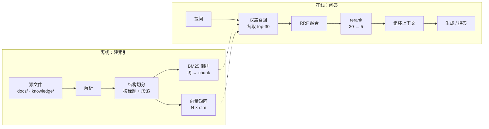
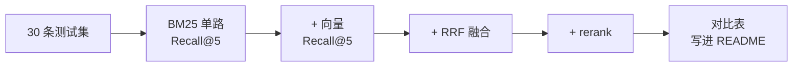

# RAG 知识库设计方案（2026-10）

| 状态 | 最后更新 | 关联代码 | 代码基线 |
|---|---|---|---|
| Draft（待定稿） | 2026-10-28 | `rag.py`、`knowledge/`、`config.py` | — |

> **这份文档解决什么**：在现有 agent 项目上加一个知识库，让模型能查项目自己的
> 技术文档和你的资料；同时这个知识库本身要是一个**可以拆开看的实验台**——
> 每一环都能手动替换、对比、量化。
>
> **怎么用**：§三 是决策清单，每环列出选项和代价，选完打勾；§五 是实施顺序，
> 按阶段推进，每阶段独立可运行。

---

## 一、先明确目标

按重要性排序，三个目标：

1. **能查**（实用）：问"上下文压缩什么时候触发"，能命中 `compact.md` 那一节，
   而不是命中十个无关文件。
2. **能学**（本来目的）：切分、召回、融合、重排、评估——每一环都能被单独替换，
   并且能用数字说清"换了之后好了多少"。
3. **能讲**（副产品）：面试时每一层都有"我试过 A 和 B，选了 B，因为在 30 条
   测试集上 Recall@5 从 0.62 提到 0.81"。

**明确的非目标**：不做多租户权限、不做千万级向量库调优、不做实时增量索引。
这三件事在你这个体量下都是纯负担。

---

## 二、整体架构



两个阶段各自独立：改切分只需要重跑离线；调召回参数只影响在线，不用重建索引。

---

## 三、逐环决策

每环列出可选方案。**标 ★ 的是我建议的**，理由写在"代价"列里——因为选型的
本质是选代价，不是选最好的。

### 3.1 分词

| 方案 | 代价 | 收益 | |
|---|---|---|---|
| 字符二元组（现状） | 索引略大（约 +15%） | 零依赖，新词也能命中 | 已实现 |
| ★ jieba 分词 | 装一个包（约 6MB） | 真词边界，虚词噪声消失；"什么东西"和"什么 东西"不再混 | 建议 |
| 带词性的自定义词典 | 要维护词典 | 能过滤动词、保留名词短语 | 过度，先不做 |

现状的二元组有个具体毛病：搜"工具是怎么注册的"，会命中大量含"是怎""么注"
的无关片段。jieba 能把"是怎么"合成一个虚词直接丢掉。

### 3.2 切分（已实现，记录现状与短板）

现状：按 markdown 标题切节 → 节内按空行分段 → 打包到 800 字，带 120 字重叠；
代码块内的空行不参与分段；标题路径（`架构总览 > 4.2 事件日志`）跟块走。

| 短板 | 影响 | 以后怎么办 |
|---|---|---|
| 不认表格边界 | 大表格可能被切成两半，表头丢失 | 表格整体成块，或按行重复表头 |
| 不认 PDF / docx | 只能吃 md / txt | 加 `pdfplumber` / `python-docx` 解析层 |
| 固定 800 字 | 代码块和散文混在一起 | 按内容类型定不同上限 |

**面试常问的"小块检索大块返回"还没做**：现在是同一块既用于检索又用于生成。
改进方向是存小块向量、返回它所属的整节（parent document retriever）。

### 3.3 向量化（★ 需要你决策）

统一接口：`embed(texts: list[str]) -> list[list[float]]`。**不管选哪个，
上层代码完全一样**，所以选错了也不返工，换一个后端即可。

| 方案 | 装什么 | 代价 | 收益 |
|---|---|---|---|
| **A. 调 API** | numpy + jieba（约 30MB，10 秒） | 要申请一个 key；联网 | 4096 维强模型，零等待；7.8 万字建一次索引约几分钱（多数有免费额度） |
| **B. 本地模型** | torch 2.5GB + transformers + 模型 | 首次装 10–20 分钟；国内可能要配镜像；磁盘 +3GB | 完全离线免费，可无限次试错，能换模型做对比实验 |
| C. 不上向量 | 只装 jieba | 学不到语义召回 | 语义匹配缺失："搜工作区找不到沙箱"这类问题无解 |

候选模型（都要支持中文）：

- API：智谱 `embedding-3`（1024 维）、硅基流动 `BAAI/bge-m3`（1024 维）、
  阿里百炼 `text-embedding-v4`
- 本地：`bge-small-zh-v1.5`（512 维，95MB，CPU 够快）→ 想再强换 `bge-base-zh-v1.5`

**建议 A**。理由不是"API 更好"，而是你现在的瓶颈不在模型质量，而在
"整条链路还没通"。A 让你十分钟内看到向量检索跑起来，把这部分学习时间
省下来给融合和重排——那两环才是面试的主战场。接口留好后，随时可换 B。

### 3.4 向量检索

| 方案 | 适用规模 | 代价 |
|---|---|---|
| ★ numpy 暴力算 | < 5 万块 | 20 行代码；264×1024 的矩阵乘约 1 毫秒 |
| faiss（IndexFlatIP / HNSW） | 10 万块以上 | 要装包；参数（M、efSearch）需要调 |
| chromadb | 任意 | 省事，但把"相似度怎么算"藏起来了 |

**建议 numpy**。你现在 264 块，用 faiss 属于负优化。而且 `np.dot(query, matrix.T)`
这一行就是"余弦相似度"的全部真相——看得见，才学得会。

### 3.5 融合（BM25 + 向量）

| 方案 | 代价 | 收益 |
|---|---|---|
| ★ RRF（倒数排序融合） | 几乎零调参 | `score = Σ 1/(60 + rank)`，只看名次不看分数，天然绕开"两路分数量纲不同" |
| 加权求和 | 要先把两路分数归一化 | 权重极其难调，且随查询变化 |

**建议 RRF**。这也是面试标准答案：为什么不用加权？因为 BM25 的分数是
无上界的（可能 3 分也可能 30 分），余弦相似度是 [-1,1] 的，直接相加等于
让 BM25 单方面决定结果。

### 3.6 重排（单点收益最大的一环）

| 方案 | 代价 | 收益 |
|---|---|---|
| ★ 本地 `bge-reranker-base` | 约 1.1GB，走 torch（和 3.3 选 B 时共用） | CPU 上 30 条约 1–2 秒，精度提升最明显 |
| API rerank | 又一个 key | 免装，但多一次网络往返 |
| 用现有 LLM 打分 | 零安装 | 贵且慢（30 条要几十秒），但**零成本试水**可以做 |

**级联是重点**：召回 30 条 → rerank 取 5 条。不要一步到位取 5 条，
否则 rerank 没有发挥空间。

### 3.7 生成与拒答

| 事项 | 做法 |
|---|---|
| 上下文注入 | 检索结果作为一条 user 消息塞进 `engine.chat_stream`，让现有循环处理 |
| 引用 | 每块带 `[1] [2]` 编号，要求模型回答时标注来源 |
| 拒答 | 提示词明确"材料里没有就说没有"；配合阈值——最高分低于 X 时直接提示"知识库没有相关内容" |
| 上下文长度 | 单次最多 4000 字符（`KB_MAX_OUTPUT`），防止撑爆 |

### 3.8 评估（最能拉开差距）

先做最小可用版本，不要一上来就上 RAGAS：

1. 手写 **30 条** `{问题, 应该命中的文件+标题}`。从真实使用中攒，别编。
2. 算两个指标：**Recall@5**（正确答案在不在前 5）、**MRR**（排第几的倒数均值）。
3. 每改一版跑一次，记录在表格里——这张表就是面试时最有说服力的材料。



---

### 第一个实验：标题权重（已完成）

同一个查询「空槽机制」，只改 `KB_TITLE_WEIGHT`（标题里的词算几遍），排序就变：

| 权重 | 第 1 名 | 第 2 名 |
|---|---|---|
| 1（和正文同权） | compact.md · 挂载点与触发条件 | **建索引**（完全无关，靠"机制"两字混进来） |
| 2 | compact.md · 挂载点与触发条件 | plugins/README · 空槽机制 |
| **3 ★ 采用** | **plugins/README · 空槽机制** | compact.md · 挂载点与触发条件 |
| 4 | 同上 | 同上（**饱和**，再大也没用） |

两条教训：

1. **参数是能测出来的，不用猜。** "chunk 设 512" 这种回答之所以站不住，
   是因为它没有对照实验。改一个值、跑同一批 query、看排序变没变，十秒的事。
2. **不是越大越好。** 权重 4 和 3 结果一样，说明这个信号已经饱和；
   继续调只是在浪费算力，还会让别的查询变差——所以要在多组查询上验证，
   这也是为什么 §3.8 的测试集必须先建。

### 第二个实验：向量检索到底补了什么（已完成）

同一批查询，两路各取前 5，只看第 1 名：

| 查询 | BM25 第 1 名 | 向量第 1 名 | 谁对 |
|---|---|---|---|
| 上下文塞满了会怎样 | read_file · 行为与输出 ✗ | compact · 挂载点与触发条件 ✓ | **向量** |
| 报错怎么办 | 切分 ✗ | 错误统一翻译 ✓ | **向量** |
| 工具怎么登记 | 注册表 · 加一个新工具 ✓ | 工具箱 · 加一个新工具 ✓ | 打平 |
| 沙箱 | 工作区沙箱 ✓ | 工作区沙箱 ✓ | 打平 |
| 模型不听话 | 评测跑分 ✗ | 失败归类 △ | 都不行 |

规律很清楚：**查询越口语化，向量越占优；查询越接近术语原文，BM25 越稳。**
"塞满了"能对上"压缩"，"报错"能对上"错误翻译"——这是关键词永远做不到的；
但"工具怎么登记"这种，两路都能中，因为文档里真的写着"登记"。

**实测开销**（283 块，text-embedding-v4，1024 维）：

| 项目 | 数值 |
|---|---|
| 建索引 | 16.2 秒，约 0.045 元（免费额度内不扣钱） |
| 索引体积 | 1.1 MB（`vectors.npy`） |
| BM25 检索 | 9 ms |
| 向量检索 | 387 ms（**其中约 380 ms 是"把查询变成向量"的那次网络请求**） |
| 融合后总计 | 315 ms |

最后两行是重点：**向量检索的成本几乎全在那一次 HTTP 往返上**，矩阵乘本身
不到 1 毫秒。这决定了后面加 rerank 时的预算——用户等 300ms 能忍，
等 1.5 秒就开始烦了。所以 rerank 只能对少数候选做，不能对全库做。

**已知问题：** 文档开头那张「状态 / 最后更新 / 关联代码」的元信息表，在向量
空间里和什么查询"都有点像"，会稳定混进结果（查"沙箱"时排第 3）。这类"万能块"
是向量检索的经典噪声源，BM25 靠 IDF 能压住，向量没有类似机制。
处理手段：建索引时过滤，或检索后按 MMR 去重。**暂不处理**，等评估集建好，
用量化数据决定值不值得动。

---

## 四、知识库的数据从哪来

这是最容易卡住的地方。好消息是：**你手上已经有两份现成语料，不用去爬、不用买。**

| 来源 | 现成量 | 怎么处理 | 优先级 |
|---|---|---|---|
| `docs/` 项目技术文档 | **7.8 万字 / 24 个文件** | 已直接索引，264 块 | 已完成 |
| `knowledge/` 手写资料 | 0（刚建） | 按主题分文件写 markdown | 高，持续投入 |
| `data.jsonl` 对话历史 | 337 条 / 676K | 蒸馏成「问题 + 结论」卡片再索引 | 中（你说后面再加） |
| `*.py` 代码 | 1949 行 | 按函数切 | 低，和 `grep` 功能重叠 |
| LLM 合成 | — | 从文档反向生成"这段能回答什么问题" | 高，做评估集时用 |

### 该放什么、不该放什么

**判断标准只有一条：模型本来不知道的东西才值得放。**

| 值得放 | 不值得放 |
|---|---|
| 你自己的取舍和判断（"这里为什么用 threading.local"） | 大段抄来的教程、维基百科内容 |
| 踩过的坑和症状（"报 SyntaxError，因为注释里写了反斜杠"） | 通用概念定义（模型早就知道） |
| 项目的隐含约定（"改前端必须用语义 token"） | 网上随手能搜到的 API 文档 |
| 术语在你项目里的**具体含义** | 泛泛而谈的"最佳实践" |

第二列的内容放进去不但没用，还会挤占检索名额——它们和问题"看起来都相关"，
却答不到点上。这是 RAG 里最常见的自欺欺人。

### 对话历史怎么蒸馏（以后要做时看这段）

不要直接把 `data.jsonl` 的原始消息切片。里面大量"好的""继续""我看看"，
切进去全是噪声。正确做法：

1. 按 `session` 分组，丢掉工具调用记录（`tool` 事件）
2. 每个 session 让模型提炼 `{当时的问题, 得出的结论, 关键决策}`
3. 存成 `knowledge/history/YYYY-MM-DD-主题.md`，**人工过一遍**再索引
4. 这一步的产物顺便就是评估集的原料

---

## 五、分阶段实施

每个阶段独立可运行，做完就能用，不用等全部完成。

| 阶段 | 做什么 | 验收标准 | 对应考点 |
|---|---|---|---|
| **0** ✅ | BM25 + 结构切分 + 索引 | 264 块，`python rag.py search` 能搜到 | 切分、倒排、BM25 |
| **1** | jieba 替换二元组 | 同一批 query 命中质量肉眼提升 | 中文分词 |
| **2** ◐ | 向量化 + 双路召回 + RRF | 通路已打通（283 块向量化、三路可对比）；**量化待评估集** | 混合检索、融合 |
| **3** | rerank 级联（30→5） | Recall 再涨一截，记录耗时 | 重排、延迟预算 |
| **4** | 30 条评估集 + 调参 | 一张"每版提升"的表 | 评估方法论 |
| **5** | 工具化 `search_kb` + 前端 | 模型能自己决定何时查 | Agentic RAG |
| 6（可选） | 对话历史蒸馏 | 能搜到"我以前怎么想的" | 数据工程 |

阶段 1–3 每个约 1–2 小时；阶段 4 最花时间，但价值最高。

---

## 六、文件规划

```
rag.py              切分 + BM25 索引 + 检索（已有）
kb_vector.py        向量化（API/本地可切）+ 向量检索 + RRF 融合
kb_rerank.py        cross-encoder 重排
kb_eval.py          评估：跑测试集、出对比表
tools/search_kb.py  工具：让模型自己查（待写）
knowledge/          语料（md/txt）
knowledge/.index/   索引产物（★ 必须 gitignore）
docs/design/        本文件
```

---

## 七、已知风险

| 风险 | 应对 |
|---|---|
| Python 3.13 装 torch 失败（3.3 选 B 时） | 退回 API 方案；或建 3.11 虚拟环境 |
| 中文 embedding 对代码、英文术语效果一般 | 混合检索天然兜底（BM25 补这块） |
| 264 块太少，指标波动大 | 别只看数字，逐条看 bad case |
| 索引文件误提交 | 加进 `.gitignore` |
| 文档改了忘记重建索引 | 工具里检测索引 mtime，过期就提示 |

---

## 附：这份方案和面试考点的对应

| 面试会问 | 这个项目里的答案在哪 |
|---|---|
| 你怎么切分？为什么这么切？ | §3.2，以及"表格/PDF 还没处理"的坦诚 |
| 为什么用混合检索？ | §3.5，BM25 补专名、向量补语义 |
| 分数怎么融合？ | RRF，以及"为什么不加权"的理由 |
| rerank 为什么有效？延迟怎么控？ | §3.6，级联 30→5 |
| 你怎么知道变好了？ | §3.8 那张逐版对比的表 |
| 效果不好怎么排查？ | 有测试集，能定位是召回没中还是生成答错 |
| 长上下文时代还要 RAG 吗？ | 能查、成本、权限、数据新鲜度，而不是"塞得下" |
