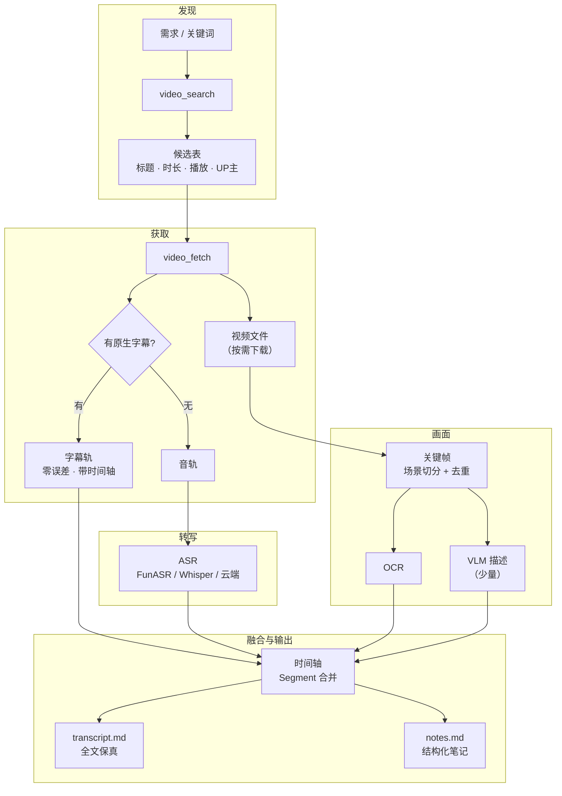
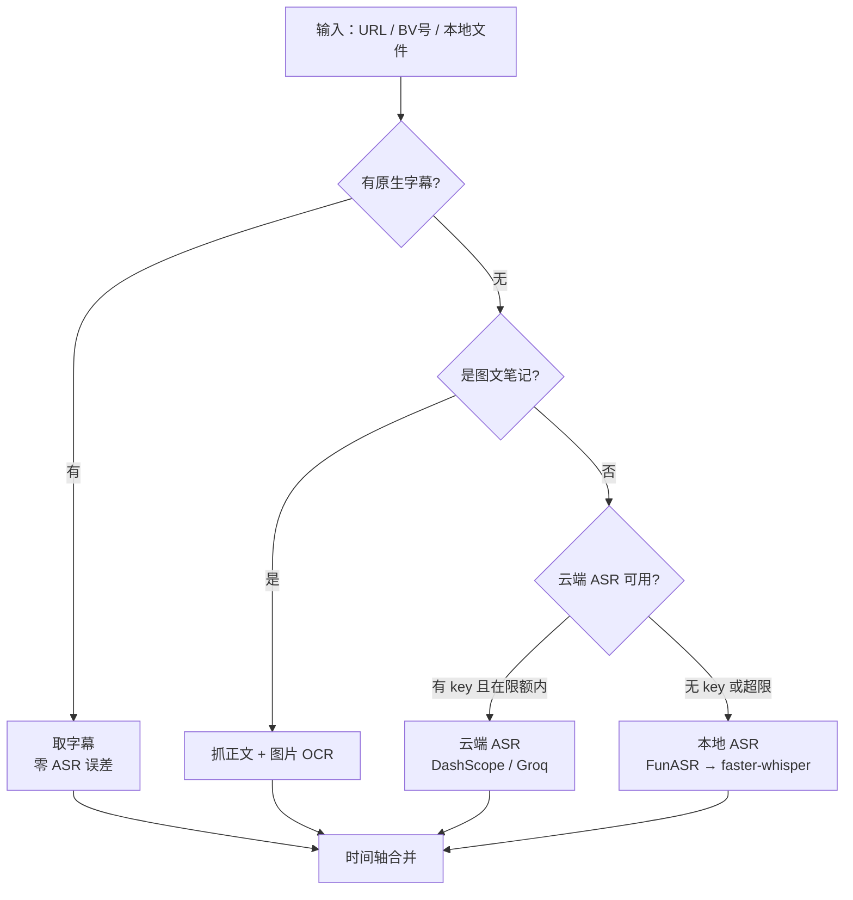

# 视频分析设计方案（2026-10）

| 状态 | 最后更新 | 关联代码 | 代码基线 |
|---|---|---|---|
| Draft（阶段 0–1 已实现，B站链路跑通） | 2026-10-30 | `videokit/`、`tools/video_*.py` | `14e7196` |

> **这份文档解决什么**：给 agent 加一只"看视频"的手——按需求去 B站 / 小红书找视频，
> 或遍历某个 UP 主 / 博主，把视频里的知识尽可能无损地变成可检索的文字。
>
> **怎么用**：§三 是全文的核心判据（"低损失"到底指什么）；§五 是数据模型，
> 动代码之前先看它；§六 是四个工具的接口契约；§八 是实施顺序，每阶段独立可跑。

---

## 一、先明确目标

三个目标，按重要性排序：

1. **能找到**（实用）：说"我想学 XX"，它能搜出候选、按播放 / 时长 / 发布时间筛，
   而不是要求我先给出一个链接。
2. **转得准**（低损失）：不只是语音转文字——PPT、代码、图表这些只存在于画面里的
   信息不能丢。这一条是整份方案的重心。
3. **能复用**（接现有系统）：产物是带时间戳的 Markdown，能直接丢进 `knowledge/`
   被现有 RAG 索引；检索命中后能回到视频的第几分几秒。

**明确的非目标**：

- 不做视频推荐算法。选哪个视频由模型读标题和简介决定，工具只负责给候选。
- 不做剪辑、二创、字幕回贴。
- 不做直播流。
- 不做帧向量检索（多模态 RAG）。第一版文本 RAG 够用，帧只作为文本的附属。

**一个前置取舍**：优先"看得懂"，不追求"看得全"。一个 2 小时的视频，全量抽帧 +
每帧调视觉模型会让成本失控，而且 90% 的帧是重复的。第一版的目标是"该留的信息留下"，
不是"每一帧都记录"。

---

## 二、整体架构



五个阶段可以独立替换：换 ASR 后端只影响「转写」，换抽帧策略只影响「画面」，
下游的 `Segment` 模型和渲染完全不动。

---

## 三、"低损失"到底损失在哪

先把问题拆开，否则"低损失"是个没法验收的口号。视频变成文字，一共丢四类东西：

| 损失类型 | 具体表现 | 手段 | 成本 |
|---|---|---|---|
| **语音 → 文字** | 同音词、专名、口语重复、无标点 | 热词表 + 只改专名的二次校对 | 低 |
| **画面 → 文字** | PPT 翻页、代码、图表、画图演示 | 关键帧 + OCR +（少量）VLM 描述 | 中 |
| **结构** | 论证链、章节、反复强调的重点 | 分段 + 章节 + 重复度检测 | 低 |
| **副语言** | 语气、强调、情绪、笑点 | SenseVoice 情感标签、语速包络 | 低 |

**第一类最容易做，也最容易被误当成全部。** 市面上多数"视频转文字"项目
（`video-to-subtitle` 那一类）只做第一类，然后管它叫"视频理解"。

**第二类是真正的分水岭。** 知识类视频里信息密度最高的地方往往不在嘴上：
讲架构时手在画图、讲代码时屏幕在滚动、讲数据时图表在变。这些内容 ASR 一个字都抓不到。
纯文本转录拿到的是一段"听起来对、但少了半张图"的内容。

**第四类几乎没人做，但几乎不要钱。** SenseVoice 的输出本来就带情感标签，
清洗时顺手留下即可，用来标注"这里是重点 / 这里是调侃"，比事后让模型猜准得多。

**结构损失靠"重复度"补。** 一个人反复讲同一个概念，说明他认为这是重点；
同一张 PPT 停 5 分钟不换，说明这段重要。这两个信号都不需要模型判断，
数一数就知道，但能显著改善章节划分。

---

## 四、逐环决策

每环列出可选方案，**标 ★ 的是建议**。选型的本质是选代价，不是选最好的。

### 4.1 发现（★ 最需要自己写的一环）

现状是所有开源 video-to-text 项目都假设"你已经有 URL"。能同时做关键词搜索 +
遍历作者主页的只有 `MediaCrawler`，但它是个爬虫工程（Playwright + 登录态 + 入库），
不是能在 agent 里调一次的函数。

| 方案 | 代价 | 收益 |
|---|---|---|
| ★ 工具返回候选表，模型决定看哪个 | 多一轮工具调用 | 和 `list_dir` → `read_file` 同构；避免一次下 20 个视频；筛选逻辑交给模型，不用写推荐算法 |
| 工具内部自动挑 top-1 | 少一轮 | 挑错了要重来；"哪个相关"本身就得读标题和简介判断 |
| 直接爬搜索结果页面 | 页面一改就废 | 省一次接口签名 |

候选表字段：`标题 / BV号或笔记ID / UP主 / 时长 / 播放 / 发布时间 / 简介前 80 字`。
**时长和播放是关键筛选项**——"我要系统学 XX"通常要 10 分钟以上的讲解，
30 秒的切片转得再准也没用。

B站接口（需要 WBI 签名 + 可选 cookie）：

- 关键词搜索：`x/web-interface/wbi/search/type?search_type=video`
- UP 主视频列表：`x/space/wbi/arc/search?mid=...`
- 字幕列表：`x/player/wbi/v2`（AI 字幕需要登录 cookie）

⚠️ `Nemo2011/bilibili-api`（4.2k）与 `SocialSisterYi/bilibili-API-collect`（20k）
**均已归档**，不能当长期依赖。策略：签名逻辑自己抄一份最小实现（约 80 行，
集中在 `videokit/bili.py` 一处），并保留"签名失效 → 退回 yt-dlp"的降级路径。

小红书：起 `XHS-Downloader` 的本地 API（`python main.py api`，端口 5556），
`POST /xhs/detail` 拿作品详情（标题、正文、标签、视频地址）。它没有关键词搜索；
关键词搜索要么上 `MediaCrawler`（重），要么先不做——见 §八 阶段 5。

### 4.2 获取

| 平台 / 形态 | 工具 | 字幕 | 备注 |
|---|---|---|---|
| B站 视频 | yt-dlp | `--write-subs --write-auto-subs` 可取 CC / AI 字幕 | 优先，零误差 |
| 小红书 视频 | XHS-Downloader | 通常无字幕 | 必须走 ASR |
| 小红书 图文 | XHS-Downloader | — | **原生文字，直接抓正文，不要 ASR** |
| 本地文件 | ffmpeg | — | 直接进 ASR |

★ **"字幕优先"是全文最重要的一个判断**：有字幕就不要跑 ASR。
字幕是人工或平台生成后挂在视频上的，自带时间轴、零识别错误、零算力。
无脑跑 Whisper 是这类项目最常见的浪费——花了十分钟，得到一个比字幕差的结果。

同理，小红书的图文笔记是**原生文字**，抓正文 + 图片 OCR 就够，
把它当视频去跑 ASR 属于方向性错误。

### 4.3 转写

统一接口：`transcribe(audio_path, lang="zh", hotwords=None) -> list[Segment]`。
不管选哪个后端，上层代码完全一样，换后端不返工。

| 方案 | 装什么 | 中文质量 | 速度 | 代价 |
|---|---|---|---|---|
| ★★ **调本机 voice2text 服务** | **什么都不用装** | 最好（large-v3-turbo） | 最快（RTF 0.11，GPU） | 依赖那个 exe；要起服务 |
| ★ 本地 faster-whisper | CTranslate2 ≈ 200MB + 模型 | 中（small 同音字多） | CPU RTF 0.19 | 轻，离线可用 |
| FunASR（Paraformer-zh + VAD + 标点） | torch ≈ 2.5GB | 最好 | 中 | 装包最重 |
| 云端 DashScope / Groq | 无 | 好 | 看网络 | 有大小限制、要 key |

**★ 首选：直接调本机那个 voice2text 服务。**

理由不是"它最强"，而是**它已经在这台机器上装好并调好了**：
自带 Python 3.10 运行时、faster-whisper、cuDNN 8、ffmpeg，
`set.ini` 里配的是 `cuda` + `float32` + `large-v3-turbo`。

我一开始绕了远路：在项目里另装 faster-whisper，又想装 CUDA 12 运行库来开 GPU
（ctranslate2 4.8 要 cuDNN 9，而系统和那个应用里都只有 cuDNN 8）。
那等于把已有的东西再买一遍，还多花 1GB。
**能复用现成的就别重造——这句话对"模型"和"轮子"同样成立。**

代价只有两个，都已处理：本机调用要绕过系统代理（这台机器的 `http_proxy`
会把 `127.0.0.1` 也发给代理，返回 502）；接口是异步的，要轮询进度。

> **本地 faster-whisper 保留为兜底**（`ASR_BACKEND = "local"`）。
> 服务没开、或者换台没装它的机器时，仍然能转，只是慢一些、错字多一些。

参考数据（**来自各项目 README 的实测，不是本项目实测**）：

| 来源 | 场景 | 数字 |
|---|---|---|
| chubbyskills | SenseVoice-Small，M3 Pro CPU | RTF 0.11（1 分钟音频约 6.6 秒） |
| chubbyskills | Qwen3-ASR-0.6B 同机 | RTF 0.80（慢约 7 倍；专名更稳但有幻觉改写风险） |
| DTK | FunASR ONNX，2 核 CPU | 3 分 13 秒音频 → 3.7 秒 |

RTF 0.11 意味着**纯 CPU 就能跑**，这决定了本方案不引入 GPU 依赖。

### 4.4 画面

四步，成本递增，按需启用：

1. **场景切分**：ffmpeg `select='gt(scene,0.3)'`，或固定间隔（默认 30 秒）。免费。
2. **去重**：相邻帧 pHash 距离低于阈值就丢。一张 PPT 停 5 分钟只留一帧。免费。
3. **OCR**：`rapidocr-onnxruntime`（ONNX，不依赖 torch，约 15MB），每帧几十毫秒。便宜。
4. **VLM 描述**：调视觉模型。**只在必要时**——见下面的判据。

★ **判据：只保留"画面说了语音没说的话"。**

对每一帧，把 OCR 文本和它所在时间段的口播文本做字符级重合度比较：

| 重合度 | 含义 | 处理 |
|---|---|---|
| > 0.7 | 讲的和写的一样（在念 PPT） | 只留一份，丢掉帧 |
| 0.3 – 0.7 | 画面补充了一部分 | 保留 OCR 文本，不调 VLM |
| < 0.3 且 OCR < 20 字 | 画面有信息但没有字（图表、画图、演示） | **调 VLM 描述** |
| < 0.3 且 OCR ≥ 20 字 | 画面是另一套内容（代码、文档） | 保留 OCR，视情况调 VLM |

这条判据把 VLM 调用量从"每 30 秒一次"压到"每 10 分钟可能一次"，
成本差两个数量级，而信息几乎不丢——因为念 PPT 的那些帧本来就没提供新东西。

### 4.5 融合：时间轴是唯一主键

所有产物都是 `Segment`，靠 `t0/t1` 对齐。合并规则：

- 语音段和字幕段**不共存**：拿到字幕就不跑 ASR，避免两套文本互相打架。
- 帧挂到覆盖它的语音段上（`frame.t0 ∈ [seg.t0, seg.t1]`）。
- 章节边界第一版用"固定 5 分钟窗口 + LLM 打标"，等评估集有了再改语义断点。

### 4.6 长视频：粗读定范围，精读补细节

1 小时的视频直接全量转写 + 抽帧，时间和钱都不划算，而且大部分内容与需求无关。
所以设两档：

| 档位 | 触发 | 做法 | 产出 |
|---|---|---|---|
| 粗读 | 时长 > `VIDEO_MAX_MINUTES`（默认 120），或用户只要"大概讲了啥" | 每 5 分钟抽一帧 + 只转写前 3 分钟，让模型判断哪几段值得精读 | 骨架 + 时间区间 |
| 精读 | 粗读选中某区间，或用户指定 `focus` | 只对该区间做完整转写 + 逐段帧判据 | 该区间的 transcript |

这其实就是人看长视频的方式：先拖进度条看目录，再挑着看。
不做这一步的后果是"每问一个问题都要等十分钟"。

### 4.7 输出：两层，不是一层

| 文件 | 性质 | 谁读 | 有损吗 |
|---|---|---|---|
| `transcript.md` | 全文保真，逐段带时间戳 | 模型需要核对原话时 | 几乎无损（只做断句和标点） |
| `notes.md` | 结构化：章节、要点、术语表、金句、待验证 | 模型默认读这个 | 有损，但是"压缩"不是"丢失" |

**为什么必须两层**：摘要一定丢信息，但把全文直接塞进上下文又太贵。
两层分工是——`notes` 负责"知道讲了什么"，`transcript` 负责"原话到底怎么说"。
要引用时按时间戳回查，链路不断。

这也正好接现有 RAG：`transcript.md` 切片时把 `t0/t1` 写进 chunk 元数据，
检索命中后能直接说"第 12 分 30 秒"。

---

## 五、数据模型

### 5.1 Segment（中间层，JSON Lines）

```json
{"t0": 754.2, "t1": 771.8, "kind": "speech", "text": "...", "source": "caption"}
{"t0": 760.0, "t1": 760.0, "kind": "frame", "ocr": "...", "vlm": "...", "hash": "..."}
{"t0": 742.0, "t1": 900.0, "kind": "chapter", "title": "为什么用混合检索"}
```

`kind` 只有四种：`speech` / `caption` / `frame` / `chapter`。
`source` 记录来源（`caption` / `funasr` / `whisper` / `dashscope` / `manual`）——
**任何一段文字都能回答"你是从哪来的"**，这是可核对性的基础，也是排查
"这段是字幕还是 ASR 编的"的唯一线索。

### 5.2 产物目录

```
<workspace>/videos/<video_id>/
  meta.json          标题、UP主、时长、URL、抓取时间、各环节参数
  source.mp4         原始视频（默认不下；下了保留 N 天）
  audio.m4a          抽出的音轨
  subtitle.srt       原生字幕（如果有）
  segments.jsonl     中间层
  transcript.md      全文保真
  notes.md           结构化笔记
  frames/            通过判据的关键帧
  seen.json          已处理过的视频 ID（增量用）
```

`videos/` 进 `.gitignore`。

---

## 六、工具接口

四个工具，都是 `tools/` 下的薄壳：解析参数 → 调 `videokit` → 返回字符串。
逻辑放包里是为了能脱离 agent 单独测试（和 `search_kb.py` 调 `rag.py` 同构）。
按项目约定：**失败返回以"错误"开头的说明，不抛异常**，让模型自己看到并调整。

### 6.1 `video_search`

```python
DESCRIPTION = {
    "name": "video_search",
    "description": (
        "按关键词或 UP 主/博主搜索视频，只返回候选的元数据（标题、时长、播放量、"
        "发布时间、简介），不下载。先用它挑，再用 video_fetch 取。"
    ),
    "parameters": {
        "type": "object",
        "properties": {
            "query": {"type": "string", "description": "关键词；与 author 二选一"},
            "author": {"type": "string", "description": "UP主名或 mid / 博主主页链接"},
            "platform": {"type": "string", "enum": ["bilibili", "xhs"]},
            "limit": {"type": "integer", "description": "返回几条（默认 15）"},
            "min_minutes": {"type": "integer", "description": "只要这个时长以上的"},
            "order": {"type": "string", "enum": ["play", "pubdate", "default"]},
        },
        "required": ["platform"],
    },
}
```

返回一张 Markdown 表。**不给推荐结论**——选哪个是模型的判断，工具一旦开始"建议"，
就会把用户带偏到它自己也没验证过的视频上。

### 6.2 `video_fetch`

| 参数 | 说明 |
|---|---|
| `url` | BV号 / 视频链接 / 小红书链接 / 本地文件路径 |
| `with_video` | 是否下载视频本体，默认 `False` |
| `max_minutes` | 超过就拒绝并提示用粗读 |

★ 默认 `with_video=False`：只取字幕或音轨。视频动辄几百 MB，
而 90% 的需求（转文字）根本不需要画面。要看画面时才下。

返回：`video_id`、有无字幕、时长、产物路径、走了降级链的哪一级。

### 6.3 `video_transcribe`

| 参数 | 说明 |
|---|---|
| `video_id` / `path` | 二选一 |
| `backend` | 默认取配置；可临时指定 `funasr` / `whisper` / `dashscope` / `groq` |
| `hotwords` | 领域词表，逗号分隔（专名、缩写、产品名） |

返回：段数、总时长、转录耗时、所用后端、`transcript.md` 路径。
**必须报告后端**——用户有权知道这份文字是字幕还是 ASR 出来的。

### 6.4 `video_digest`

| 参数 | 说明 |
|---|---|
| `video_id` | 必填 |
| `mode` | `notes`（默认，只出结构化笔记）/ `full`（含 transcript 摘录） |
| `focus` | 关注点，如"只讲架构的部分" |

`focus` 是关键设计：同一个视频，"讲了什么"和"里面关于缓存的部分怎么说"
应该产出不同的笔记。这比生成一份万能的、谁看了都用不上的摘要有用得多。

---

## 七、降级链



**每一级降级都要说清原因**，不能静默降级。否则用户以为拿到的是字幕版，
其实是 ASR 版——两者的准确率不是一个量级，而肉眼很难分辨。

---

## 八、分阶段实施

每个阶段独立可运行，做完就能用，不用等全部完成。

| 阶段 | 做什么 | 验收标准 | 状态 |
|---|---|---|---|
| **0** | `video_fetch` + `video_transcribe`，仅 B站 URL，字幕优先 | 给一个 BV 号，拿到带时间戳的 `transcript.md` | ✅ 已达成 |
| **1** | `video_search`（关键词 + UP 主列表） | 说"搜 XX"，拿到候选表并能选中一个继续 | ✅ 已达成 |
| **2** | `video_digest`（纯文本：章节 + `notes.md`） | 2 小时视频产出 8–12 个章节，人工核对无明显错位 | 未开始 |
| **3** | 关键帧 + OCR + 时间轴融合 | 代码 / PPT 类视频的 notes 里出现画面才有的内容 | 未开始 |
| **4** | 重合度判据 + 少量 VLM + 热词校对 | VLM 调用 < 每 10 分钟 1 次，且不丢关键画面 | 未开始 |
| **5** | 小红书（图文优先，视频次之） | 一条图文笔记能完整入库；视频能转写 | 未开始 |
| **6** | 产物进 `knowledge/`，被现有 RAG 索引 | 问视频里的内容，`search_kb` 能命中并标出时间戳 | 未开始 |

阶段 0 是"跑通"，阶段 3 是"和市面上项目拉开差距"，阶段 6 是"真正变成知识"。
其余是可选增强。**阶段 0 实际花掉的时间：能用约半天，调通约一天**——
时间基本都花在三个环境坑（`av` 版本、HF 镜像、简繁漂移）上，见 §十五。

---

## 九、文件规划

```
videokit/
  __init__.py
  bili.py         ✅ B站：WBI 签名、搜索、UP主列表、字幕、音频流
  asr.py          ✅ 本地 faster-whisper 兜底（繁简归一、本地缓存优先）
  v2t.py          ✅ 调本机 voice2text 服务（★ 默认后端，免安装、有 GPU）
  timeline.py     ✅ Segment 模型、合并、渲染 markdown
  store.py        ✅ 产物落盘、ID 校验、seen 增量
  media.py        ○  ffmpeg 封装（切帧用）——阶段 3 才需要
  xhs.py          ○  小红书：调本地 XHS-Downloader API——阶段 5
  frames.py       ○  场景切分、pHash 去重、OCR、VLM、重合度判据——阶段 3/4
tools/
  video_search.py     ✅
  video_fetch.py      ✅
  video_transcribe.py ✅
  video_batch.py      ✅ 按作者批量处理（时间预算 + 续跑）
  video_digest.py     ○  阶段 2
videos/           产物（★ 已加进 .gitignore）
```

没做 `media.py` 的原因：B站的 DASH 音轨本身就是 m4a，
faster-whisper 底层的 PyAV 能直接解码，**转写这条路根本不需要 ffmpeg**。
等阶段 3 要抽帧时再补。

不把这些全塞进 `tools/` 的原因：工具文件的价值是"给模型看说明书"，
一旦超过两三百行就既难测也难读。现有 `search_kb.py`（5.5KB）调 `rag.py`
就是这个分层的样板，照抄即可。

---

## 十、配置与依赖

### 10.1 新增配置（`config.example.py`）

```python
# ===== 视频分析 =====

# 总开关：True = 多出 4 个 video_* 工具
ENABLE_VIDEO = True

# B站 cookie（可选）：填了才能拿 AI 字幕和高清流；不填也能拿 CC 字幕
VIDEO_BILI_COOKIE = ""

# 小红书后端：本地起 XHS-Downloader 的 API 模式
VIDEO_XHS_API = "http://127.0.0.1:5556"

# ASR 后端：dashscope | groq | funasr | faster-whisper
ASR_BACKEND = "dashscope"

# 领域词表（专名、缩写、产品名），逗号分隔——显著降低专名错字
ASR_HOTWORDS = ""

# 抽帧：兜底间隔（秒）、场景切分灵敏度、单视频最多留几帧
VIDEO_FRAME_INTERVAL = 30
VIDEO_SCENE_THRESHOLD = 0.3
VIDEO_FRAME_MAX = 60

# 是否允许调视觉模型描述画面（默认关：先看 OCR 够不够）
VIDEO_VLM_DESC = False

# 超过这个时长走"粗读"
VIDEO_MAX_MINUTES = 120

# 下载的视频本体保留几天（0 = 立即删）
VIDEO_KEEP_SOURCE_DAYS = 7
```

### 10.2 依赖清单

| 依赖 | 用途 | 体积 | 必需 |
|---|---|---|---|
| **本机 voice2text 服务** | 转写（自带运行时 + GPU + turbo） | 用现成的，**0 安装** | ★ 默认后端 |
| requests | 调 B站 / 本机服务（已有） | — | 必须 |
| zhconv | 繁→简归一化 | < 1MB | 建议 |
| ffmpeg | 抽帧、转码（voice2text 自带一份） | ≈ 80MB | 阶段 3 才要 |
| faster-whisper | 本地兜底转写 | ≈ 200MB + 模型 | 可选 |
| **av < 16**（实测 15.1.0） | 上面那条的音频解码 | 31MB | 仅本地兜底要 |
| rapidocr-onnxruntime | 帧 OCR | ≈ 15MB | 阶段 3 |
| XHS-Downloader | 小红书后端 | 独立服务 | 阶段 5 |

★ **默认路径是零安装**：转写交给本机已有服务，转文字这条路一个包都不用装。
`faster-whisper` / `av` 只在 `ASR_BACKEND = "local"` 时才需要。

★ **两条版本约束（本地兜底路线才涉及）**：

1. `av` 必须 **< 16**。PyAV 19 删掉了 `av.open()` 的 `metadata_errors` 参数，
   而 faster-whisper 1.2.1（当前最新）还在传它，于是报
   `open() got an unexpected keyword argument 'metadata_errors'`。
   安装：`pip install faster-whisper "av==15.1.0"`
2. 模型下载要过两道网：`HF_ENDPOINT=https://hf-mirror.com`（国内直连不通）
   和 `HF_HUB_DISABLE_XET=1`（新版 hub 默认走 Xet，镜像不支持会 401）。
   代码里已经默认设好，改 `config.py` 的 `HF_ENDPOINT` 可关掉。

★ **torch 那 2.5GB 是这个功能最贵的一项**。所以默认走云端 ASR，
本地只在"量大"或"不想把音频传出去"时才装。和 RAG 那次的判断一致：
先通链路，再优化部署。

---

## 十一、和现有系统的接点

1. **不新增空槽。** 四个工具走标准 `register()` 流程，`toolbox.load_tools()`
   自动加载，引擎一行都不用改。
2. **产物受工作区约束。** `videos/` 落在工作区下，路径走 `safe_path()`，
   自然继承"被关在圈里"的边界。
3. **进 RAG 是终点。** `transcript.md` 丢进 `knowledge/videos/`，
   现有 BM25 + 向量双路就能索引；切片时把 `t0/t1` 写进 chunk 元数据，
   检索命中能回指时间戳。**视频转文字不是目的，能被检索到才是。**
4. **`before_tool` 适合做长任务确认。** 转写 1 小时视频要几分钟，
   可以挂一个插件在 `video_transcribe` 前提示"预计 3 分钟，继续吗"——
   这正是 `hooks.py` 里说的"危险操作要确认"那个位置的用法。
5. **子代理适合批量粗读。** `video_search` 出 20 个候选、要逐个看简介判断时，
   派 `spawn_agent` 去跑，只把结论带回主对话——正是它设计的用途，
   也能避免 20 个视频的元数据把主上下文撑满。

---

## 十二、维护约定

| 改了什么 | 要同步什么 |
|---|---|
| 平台接口 / 签名 | `videokit/bili.py`、`xhs.py` 顶部注释写明"最后验证日期"，本文件 §4.1 的接口清单 |
| ASR 后端 | `videokit/asr.py` 的统一接口签名不变；本文件 §4.3 的选型表 |
| 重合度阈值 | 改之前先跑 §十四 的实验，把结论写回 §4.4 的表 |
| 新增配置项 | `config.example.py`（带中文注释）+ 本文件 §10.1 |
| `Segment` 结构 | 本文件 §5.1（这是唯一信息源，别在代码注释里再抄一份） |
| 产物目录结构 | 本文件 §5.2 + `.gitignore` |

**两条硬约定**：

- `videos/`、`*.mp4`、`*.m4a` 必须进 `.gitignore`。产物体积会把仓库撑爆。
- `cookie`、`API Key` 一律走 `config.py`，不写进工具文件、不写进产物 `meta.json`。
  导出 `meta.json` 给外部时要先脱敏。

---

## 十三、已知风险

| 风险 | 影响 | 应对 |
|---|---|---|
| B站 WBI 签名变更 | 搜索 / 字幕全挂 | 签名逻辑集中在 `bili.py` 一处；失效时用 yt-dlp 兜底；不做多平台签名逆向 |
| `bilibili-api` 已归档 | 不能当长期依赖 | 只抄最小实现，不引库 |
| 小红书风控 | 采集失败、账号风险 | 限速 ≥1 秒/次；失败即停不重试；cookie 只读不写；先做图文 |
| 长视频 ASR 耗时 | 用户等不住 | 分段落盘、可断点续传；超 `VIDEO_MAX_MINUTES` 走粗读 |
| VLM 费用失控 | 一次几块钱 | 重合度判据 + `VIDEO_FRAME_MAX` 硬上限 + 默认关闭 |
| 字幕与口播不一致（UP 主改过字幕） | 转写"太干净"反而失真 | `source` 字段标明来源；抽样比对；不一致时以字幕为准并标注 |
| 产物体积 | 磁盘撑爆 | `VIDEO_KEEP_SOURCE_DAYS` 自动清理；默认不下视频 |
| 版权与平台条款 | 合规风险 | 只处理自己有权访问的内容；产物自用不二次分发；不做批量爬 |

---

## 十四、两个待测的实验

做完阶段 4 再做，不着急——但**这两个数字决定了参数，不该靠猜**。

**实验一：重合度阈值到底该取多少？**

拿 10 个 PPT 类视频，人工标"这一帧要不要留"，在 0.5 / 0.6 / 0.7 / 0.8
四档上各跑一遍，看"漏留"和"误留"的比例。这和 RAG 那次 `KB_TITLE_WEIGHT`
的实验同构：改一个值、跑同一批样本、看结果变没变，十秒的事。

**实验二：字幕和 ASR 到底差多少？**

同一个视频，一份原生字幕、一份 ASR 结果，用字符级编辑距离算差异率。
这个数字决定了"字幕优先"值不值得为它维护一条降级链。
预期差 5–15%，但**没测过，所以不算数**。

**实验三：small 换 medium，值不值那三倍时间？**

拿同一段 3 分钟（含已知的五个同音字错例：翻译/方案/GPT-4o/存入/产出），
`small` 与 `medium` 各跑一遍，数错字还剩几个、各花多少秒。
如果 medium 把错字从 5 个压到 1 个，而时间从 35 秒涨到 100 秒——
那对"要被引用"的场景是值的，对"先看个大概"是不值的。
**这个实验一次就能做完，但目前还没做**，所以文档里所有"medium 更准"都是推测。

---

## 十五、实施记录：B站链路（2026-10-30 实测）

阶段 0–1 已落地，代码在 `videokit/`（4 个模块）+ `tools/video_*.py`（3 个工具）。
下面是真跑一遍的数字，不是估算。

**样本**：`BV1JLN2z4EZQ`《RAG 工作机制详解》，17:01，UP主「马克的技术工作坊」。

| 环节 | 实测 |
|---|---|
| 搜索 | 关键词「RAG 原理」+ `min_minutes=10`，20 条结果里筛出 8 条，含这条 17 分钟讲解 |
| 获取 | **未登录拿不到字幕**（10 个样本视频，字幕数全为 0）；下载音轨 15.4 MB ≈ **0.9 MB/分钟** |
| 转写（本地 small） | int8 / CPU：190.1 秒，RTF 0.19 |
| 转写（本机服务 turbo） | **114.4 秒，RTF 0.11**（含上传 + 转 wav + 轮询） |
| 产物 | 314 条原始句 → 合并成 34 段 / 5849 字 / 覆盖 **17:00**（比 small 多覆盖 2 秒） |

### 三个必须知道的坑（都已修在代码里）

**1. 未登录 = 没有字幕。** 这不是"视频没字幕"，是权限问题。
扫了 10 个知识类视频，`/x/player/v2` 的 `subtitles` 全是空数组。
所以「字幕优先」这条最优路径，在没有 `VIDEO_BILI_COOKIE` 时形同虚设——
实际跑的都是 ASR。**配了 cookie 才算真正走字幕路径。**

**2. Whisper 的简繁是随机漂移的。** 第一次跑出来，6:28 之后整段变成繁体
（"實際上我們在RAG裡面用到的香量維度"），同一段重跑又是简体。
往 `initial_prompt` 里加"请用简体中文"有两个坏处：一是**指令本身会被当成前文
复读出来**（实测开头多出"再生成,所以叫做…"），二是并不保证遵守。
最终方案：`zhconv` 做确定性繁→简转换，零成本零风险。

**3. `hotwords` 和 `initial_prompt` 不是一回事。** 术语要传给 `hotwords` 参数，
它只做偏置；塞进 `initial_prompt` 会被模型当"上一段话"接着写。
换成 `hotwords` 后，"向量/Embedding/召回"这些词稳定正确。

### 一个走错又走回来的弯路：别在已有轮子旁边再造一个

本地 small 跑出来的稿子，同音字多到没法直接引用：

| 原文 | 应为 |
|---|---|
| 搬以过来 | 翻译过来 |
| AI 问答发案 | 问答方案 |
| GBT-4O | GPT-4o |
| 锁印 / 向量团入 / 铲出 | 索引 / 存入 / 产出 |

我当时的思路是"装个更大的模型"：`large-v3-turbo`，还想顺手把 GPU 也开起来。
于是往项目里装 faster-whisper、又准备装 CUDA 12 + cuDNN 9（要 1GB）。

**但用户一句话点破了：`D:\project\voice2text` 那个项目本来就能跑。**
进去一看，它是自包含的打包应用——自带 Python 3.10 运行时、faster-whisper、
cuDNN 8、ffmpeg，`set.ini` 里配的正是 `cuda` + `large-v3-turbo`。
也就是说：**硬件、模型、运行库，一样都不缺，缺的只是"去调它"这一步。**

改成调它的 HTTP 接口（`/upload` → `/process` → 轮询 `/progressbar`）之后：

- 一行依赖没装，转写质量直接从"同音字满篇"跳到"八个已知错词全清零"；
- 17 分钟视频 114 秒转完，比本地 small 还快 40%；
- 代价只有两个：本机调用要 `trust_env=False` 绕过系统代理（否则 502），
  以及接口是异步的、必须轮询。

**教训**：优化之前先清点手上已有的东西。"装个更好的模型"是默认反射，
但更好的模型可能已经在硬盘上躺着了。

### 补充：按 UP 主批量取（曾经以为做不到）

一开始 `space/wbi/arc/search`（列某个 UP 的全部作品）必挂 `-352 风控校验失败`，
我据此判断"没有 cookie 这条路不可用"，还建议砍掉 `author` 参数。
**这个判断是错的**——真正的缺口是**设备指纹参数**：

```
platform=web
web_location=1550101
dm_img_list=[]
dm_img_str=<base64("WebGL 1.0 (OpenGL ES 2.0 Chromium)")>
dm_cover_img_str=<base64("ANGLE (NVIDIA, ... Direct3D11 vs_5_0 ps_5_0), or similar")>
```

两个必须做对的地方：

1. **这些参数要一起参与 WBI 签名**。只加不签仍然 `-352`；加了再签，免登录就能过。
   B站只检查"有没有"，不校验真伪（固定值即可）。
2. **接口另行限流**。实测：连打 4 次只成 1 次；拉开 8 秒约 2/3；`ps=50` 直接被拒。
   所以单页取 30、两次请求至少隔 7 秒。

于是 `user_videos()` 变成：设备指纹 + 节流 + 按页聚合 + 结果落盘缓存（一天）+
**断点续取**（要更多时从上次那页接着翻，不整段重爬）+ **部分成功**
（第 5 页被拦就把前 4 页给出去，而不是整体失败）。

实测：142 个视频的号，取回 120 条用 49 秒；再问一次 0.01 秒（缓存）。

配套的 `video_batch` 工具按**时间预算**切批（默认 300 秒），进度直接看文件系统
（`transcript.md` 在 = 做完了），不另存状态——手动删目录或中途崩了都能自动接上。
单个失败不中断整批。

实测：`action=transcribe`、2 个短视频，68 秒完成（含转写服务冷启动）。

### 剩下的错：REG

turbo 之后唯一稳定的错，是 **RAG 被听成 REG**（10 处里错 6 处）。
这是英文缩写在中文语境里的固有难点，换模型也不保证修好。

处理办法不是继续换模型，而是一张**确定性纠错表**（`config.ASR_FIXES = "REG=RAG"`）。
关键在于它放在**渲染层**而不是转写层——改纠错规则只要重新渲染，**1 秒出结果**，
不用把 ASR 再跑两分钟。这条和下面"存储修正"是同一个原则：
**数据保持原样，解释可以反复重做。**

### 质量现状

- 语音 → 文字：**基本可用**，专名对了、标点齐了、时间轴完整；
- 还有一个"靠谱的"（疑似"Coze 的"）这类靠上下文才能判断的错——属于该由
  语言模型在笔记阶段修的，不该在 ASR 这一层死磕；
- 画面 → 文字：**还没开始**（阶段 3）。这是四类损失里最大的一块，
  也是和开源项目拉开差距的地方。

### 一个存储上的设计修正

`segments.jsonl` 原来存的是"合并后的段落"，跑完才发现不对：
合并是**给人读的排版**，属于展示层；原始句子才是数据。
现在改成 jsonl 存 314 条原始句，合并只发生在渲染时——
以后改合并参数（180 字、2.5 秒停顿）不用重跑 3 分钟的 ASR。

---

## 附：可选借鉴的项目

| 项目 | 借什么 | 不借什么 |
|---|---|---|
| `chubbyguan/chubbyskills`（1.3k） | 字幕优先的降级链、多后端 ASR 接口、带 frontmatter 的产物格式 | 14 个 skill 的组织方式（现有工具系统已经够用） |
| `NanmiCoder/MediaCrawler`（69k） | 小红书 / B站搜索与签名思路 | Playwright + 登录态 + 入库那一整套工程 |
| `JoeanAmier/XHS-Downloader`（13k） | 直接起它的本地 API 当小红书后端 | 自己重写小红书签名 |
| `Evil0ctal/Douyin_TikTok_Download_API`（21k） | MCP 工具粒度设计（少而正交） | Postgres + Redis + Docker 的重架构 |
| `yuxino-labs/koma`（298） | 关键帧 + 字幕 + 章节的融合方式、导出格式 | 它只吃直链 MP4，主动放弃了平台链接 |
| `HKUDS/VideoRAG`（3.5k） | 长视频分层索引的思路 | 多模态向量那一套（第一版用不上） |
| `modelscope/FunASR`（21k）、`SYSTRAN/faster-whisper`（26k） | 直接当 ASR 后端 | — |
