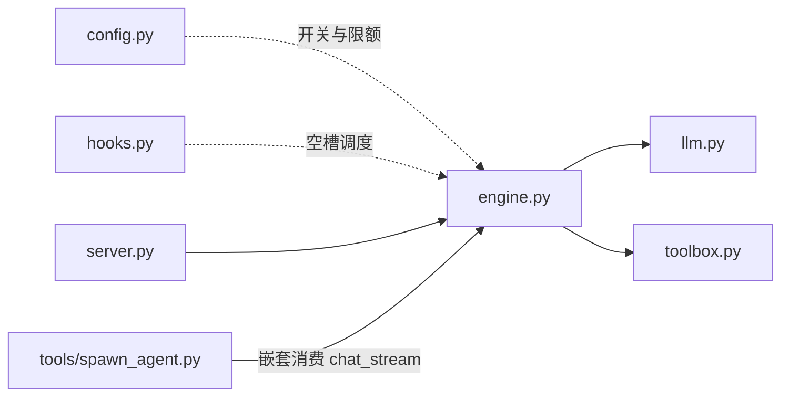
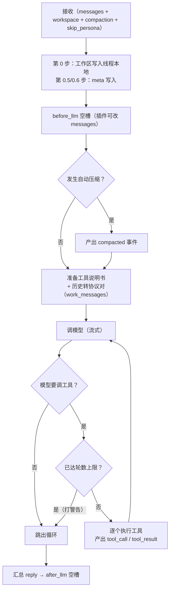

# 模块：engine（引擎）

| 状态 | 最后更新 | 关联代码 | 代码基线 |
|---|---|---|---|
| Stable | 2026-10-16 | `engine.py` | `983b38d` |

## 1. 模块职责

引擎是系统的**调度中枢**：把一次对话需要经过的所有环节，按正确顺序串起来。
它自己不干具体活——调模型交给 `llm`、执行工具交给 `toolbox`、扩展点交给
`hooks` 上的插件；它只负责三件事：

1. 维护 `ctx`（共享数据袋），并在正确时机"路过"空槽；
2. 跑 **agent 循环**（调模型 ⇄ 执行工具，多轮）；
3. 把过程产出为**事件流**（`text` / `tool_call` / `tool_result` / `compacted`）。

对外三个函数：`chat()`（非流式简单版）、`chat_stream()`（主路径）、
`load_plugins()`（启动时加载插件）。

## 2. 在系统中的位置



- **依赖**：`config`（开关与限额）、`hooks`（空槽调度）、`llm`（模型）、`toolbox`（工具）。
- **被调用**：`server.py`（两个聊天接口）、`tools/spawn_agent.py`（子代理把
  `chat_stream` 整段消费掉——本模块天生可嵌套，见 ADR-007）。

## 3. 对外接口

### `chat(messages) -> str`

非流式"简单版"对话：`before_llm` 空槽 → `llm.chat` → `after_llm` 空槽，返回回答。

- **特点**：不走工具循环、不带流式（`llm.chat` 本身不支持工具）；
- **被谁用**：`server.py` 的 `POST /api/chat`。前端当前默认走流式接口，
  这个保留作为"最简形态"的入口（也是教学上的对照版本）。

### `chat_stream(messages, workspace=None, compaction=None, skip_persona=False)`

**生成器**：流式 + 工具循环，系统的主路径。逐个产出事件字典。

**参数**：

| 参数 | 含义 |
|---|---|
| `messages` | 会话完整历史（含 role=tool 的工具记录；后端负责转换协议） |
| `workspace` | 本会话工作区（None = 默认项目目录）；写入线程本地，供所有工具读取 |
| `compaction` | 会话压缩状态（`{"summary", "first_kept_index"}` 或 None）；放进 `ctx["meta"]` 供压缩插件"应用" |
| `skip_persona` | 跳过项目人设（默认 False）；子代理专用（它自带 `SUBAGENT_PROMPT`） |

**产出事件**：

| 事件 | 结构 | 含义 |
|---|---|---|
| `text` | `{"type": "text", "text": "..."}` | 文字增量（打字机的源头） |
| `tool_call` | `{"type": "tool_call", "name": ..., "arguments": {...}}` | 即将执行某个工具（arguments 已解析成字典） |
| `tool_result` | `{"type": "tool_result", "name", "arguments", "ok", "result", "extra"?}` | 工具执行完毕；`extra` = 附件（如子代理完整过程） |
| `compacted` | `{"type": "compacted", "summary", "first_kept_index", "tokens_before"}` | 本轮发生了自动压缩 |

### `load_plugins()`

自动加载 `plugins/` 目录的所有插件（`pkgutil` 遍历，跳过 `_` 开头文件），
每个文件被"执行"一遍时，里面的 `append` 代码就把函数挂上了空槽。
`server.py` 启动时调用一次——"文件即插件"的实现处。

## 4. 内部实现

### 4.1 ctx：共享数据袋

```python
ctx = { "messages": ..., "reply": None, "meta": {} }
```

插件通过**原地修改 ctx** 参与流程（没有返回值约定）。`meta` 里目前的约定键：

| 键 | 方向 | 谁写 → 谁读 |
|---|---|---|
| `compaction` | 入 | engine 写（来自参数）→ compact 插件读（应用旧压缩） |
| `skip_persona` | 入 | engine 写（来自参数）→ system_prompt 插件读（收手） |
| `new_compaction` | 出 | compact 插件写（生成了新摘要）→ engine 读（产出事件） |
| `tokens_before_compact` | 出 | compact 插件写 → engine 读（塞进事件给前端） |

### 4.2 chat_stream 的完整流程



分步说明（对照上图）：

1. **第 0 步**：`toolbox.set_workspace(workspace)`——把工作区记进线程本地，
   接下来所有工具都被锁在它里面干活（多线程服务器防串台的关键）。
2. **第 0.5 / 0.6 步**：把 `compaction` / `skip_persona` 放进 `ctx["meta"]`。
3. **before_llm 空槽**：插件照常工作（插人设；compact 插件"应用旧压缩 +
   必要时生成新摘要"，结果写在 meta 里）。
4. **compacted 事件**：如果 meta 里有 `new_compaction`，立刻产出一条——
   前端的用量条、压缩卡片就靠它。
5. **准备两份消息**：
   - `tools_desc` = `toolbox.all_descriptions()`（看 `ENABLE_TOOLS` 开关；
     禁用名单里的工具不会出现——防套娃第一道门）；
   - `work_messages` = `_convert_tool_history(ctx["messages"])`——
     工具记录转成协议对（§4.4），之后的工具对话都追加在它身上，
     **不动原来的 messages 列表**。
6. **agent 循环**（§4.3）。
7. **收尾**：`ctx["reply"] = "".join(text_pieces)`（全部文字拼起来给
   after_llm 用），然后跑 after_llm——外面套了 try/except，
   插件出错只打警告、不影响已经流出去的内容（§4.5）。

### 4.3 agent 循环（逐行拆解）

```python
while True:
    for event in llm.chat_stream(work_messages, tools=tools_desc):
        if event["type"] == "text":
            text_pieces.append(event["text"]);  yield event   # 文字直接转交
        elif event["type"] == "tool_calls":
            pending_calls = event["tool_calls"]               # 攒起来
    if not pending_calls: break                               # 答完了 → 收工
    if config.MAX_TOOL_ROUNDS > 0 and used_rounds >= config.MAX_TOOL_ROUNDS:
        print("警告…"); break                                 # 只在配了正数时生效
    used_rounds += 1
    ...（协议回填 + 逐个执行工具 + 结果回填，见下）
```

要点：

- **轮次上限默认关闭**：`MAX_TOOL_ROUNDS = 0` 表示不限制（与 Pi / dsh 一致，让模型自己决定何时收工）；
  配了正数才当保险丝用——先检查后自增，达到上限时**当前这批**工具也不会执行（打警告收工）。
  ★ 已知缺陷：撞上限是"直接截断"，模型没机会说"我没做完"，链路日志还会记成 `ok`；
- **真正的刹车是「停止」按钮**：前端 `AbortController` → 断连 → `server.py` 捕获
  `ConnectionError` → `stream.close()` → 引擎的 `finally` 把链路记成 `interrupted`；
- **协议回填**：执行前，先把"模型要求调工具"按官方格式记进工作历史
  （assistant 消息 + `tool_calls` 字段）；
- 每个待执行的工具走四步：

  1. 参数解析（`json.loads`；坏 JSON 兜底成空字典 `{}`，不崩）；
  2. 产出 `tool_call` 事件（前端显示"正在调用…"）；
  3. `toolbox.call(name, arguments)` 真正执行，随后
     `toolbox.take_attachments()` 取走附件（如子代理的完整过程）；
  4. 产出 `tool_result` 事件（有附件则带上 `extra`），并把结果按协议
     回填工作历史（`role=tool` + `tool_call_id`）。

### 4.4 `_convert_tool_history()`：历史工具记录 → 协议对

**为什么需要它**：工具记录在存储/显示层是一条规定"`role=tool` 的条目"
（前端渲染成灰色卡片很方便），但发给模型时必须还原成官方协议的**成对**格式：

```
assistant（content 空 + tool_calls 字段）  +  tool（tool_call_id + 结果）
```

**转换规则**：

- 遇到 `role=tool` 的条目 → 展开成上面两条；
- `call_id` 就地生成：`f"hist_{len(out)}"`——只需在**本次请求内**配对，
  不需要全局唯一（历史调用早已结束，没有并发配对问题）；
- `arguments` 从字典转回 JSON 字符串（`ensure_ascii=False`）；
- 其他角色原样保留。

**效果**：模型能"看到"自己之前读过什么文件、执行过什么——
不用每次重新读（这个能力曾经丢失过，是专门修复的回归问题）。

### 4.5 收尾：reply 汇总与 after_llm 容错

`after_llm` 拿得到完整回答（`ctx["reply"]`），但**改不了已经流出去的
内容**——这是流式架构的本质取舍，after_llm 只服务记录类用途（如 logger 插件）。
所以这里套了 try/except：插件报错只打警告，用户已经看到的内容不受影响。

## 5. 交互关系

| 场景 | 调用方 | 调用的接口 | 说明 |
|---|---|---|---|
| 流式聊天（主路径） | `server.py` → `POST /api/chat/stream` | `chat_stream()` | 事件流原样转发为 SSE |
| 普通聊天（保留接口） | `server.py` → `POST /api/chat` | `chat()` | 前端当前不使用 |
| 子代理干活 | `tools/spawn_agent.py` | `chat_stream()` | 嵌套消费；传 `skip_persona=True`、继承工作区 |
| 启动加载插件 | `server.py` 的 `main()` | `load_plugins()` | 一次性 |

## 6. 设计决策

1. **循环与流式"合体"在一个生成器里**：`chat_stream` 既是"控制器"
   （调度多轮工具）又是"事件源"（往外吐过程）。不做成回调或两套接口——
   调用方 `for event in ...` 就能消费，简单且可嵌套（子代理依赖这一点）。
2. **事件用字典 + `type` 字段分发**：消费方（server/前端）用一个
   `if/elif` 链就能处理；将来加新事件类型，旧消费方直接忽略，天然兼容。
3. **工具历史"存"与"发"两种格式分离**：存储用 `role=tool` 单条
   （前端友好），发送前转协议对（模型协议要求）。转换收在本模块一处，
   不污染存储层和前端。
4. **after_llm 容错**：日志类插件不该影响用户体验——宁可丢一条日志，
   不能打崩一次对话。
5. **子代理复用本模块**（不造新引擎）：见 ADR-007。

## 7. 扩展指南

### 加一个新的流式事件类型（示例：reasoning 思考内容）

四步链路，每步一个文件：

1. `llm.py`：解析 delta 时产出新事件；
2. `engine.py`：在循环里把该事件**原样转发**（照抄 text 分支）；
3. `server.py`：**不用改**——`_send_sse` 是原样序列化；
4. 前端：加一个 `msg.type === "reasoning"` 分支处理显示。

### 加一个新的空槽时机

`hooks.py` 里加一个新列表（文件注释里留了示例位置），在 engine 流程里
`hooks.run(新槽, ctx)` 一次，插件照常 `append`。

### 调整轮次上限（或关掉它）

`config.py` 的 `MAX_TOOL_ROUNDS`：**0 = 不限制（默认）**；正数 = 最多连续调几轮工具。
改完要重启服务才生效。

### 想要"每轮工具执行前后的中间件"

执行前——挂 `before_tool` 空槽（可拦截）；
执行后——目前没有专用槽，可在 `tool_result` 产出处加，或新增一个空槽。

## 8. 已知限制与坑

- **流式的本质取舍**：`after_llm` 无法修改已流出的内容（见 §4.5）；
- **`work_messages` 是副本**：工具对话不写回 `ctx["messages"]`——
  记账由前端负责（所见即所记），引擎不重复记录。理解这一点需要
  对照前端"记账"逻辑看，否则容易误以为"工具记录丢了"；
- **错误不吞**：`llm` 层异常直接向上抛（server 捕获后转为 SSE 错误消息）；
  本模块只在 after_llm 处做容错；
- **`used_rounds` 每次调用独立**：保险丝是"单次对话内"的计数，
  不会跨请求累计；
- **保险丝语义**：触发时当前整批工具都会跳过（先检查后执行）。
