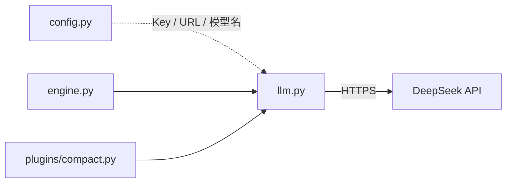
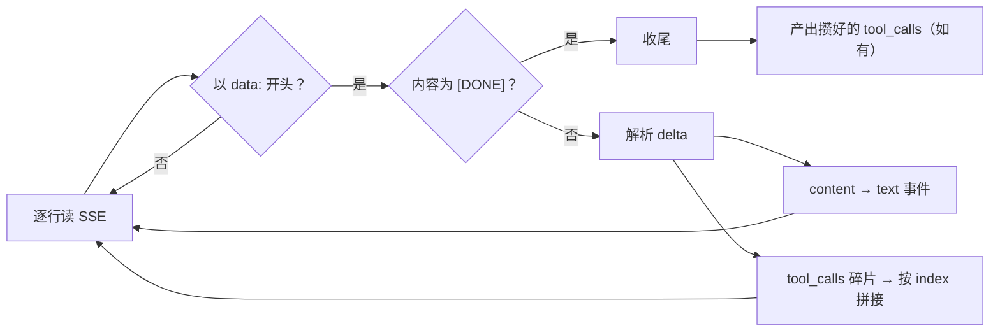

# 模块：llm（模型接入）

| 状态 | 最后更新 | 关联代码 | 代码基线 |
|---|---|---|---|
| Stable | 2026-10-16 | `llm.py` | `5a774e1` |

## 1. 模块职责

`llm.py` 是系统中**唯一和模型说话的人**：把消息数组发给 DeepSeek，
再把服务端的返回翻译成项目内部统一的"事件"。它只负责通信，不做任何决策——
发什么历史、要不要工具、什么时候压缩，全部由上层（engine / 插件）决定。

对外两个出口：

| 出口 | 形态 | 谁在用 | 为什么 |
|---|---|---|---|
| `chat()` | 非流式，等完整回答一次性返回 | `compact` 插件（生成摘要） | 摘要不需要打字机效果，代码简单 |
| `chat_stream()` | 流式生成器，边收边吐 | 主对话、子代理循环 | 打字机体验 + agent 循环的基础 |

## 2. 在系统中的位置

只依赖标准库（`json` / `urllib`）和 `config.py`（Key / 地址 / 模型名）；
被 `engine.py`（主对话与子代理）和 `plugins/compact.py`（摘要）调用。



## 3. 对外接口

### `chat(messages) -> str`

普通版：把完整消息列表发出去，等模型说完，返回回答字符串。

- **参数**：`messages` —— OpenAI 格式的消息数组，
  每项形如 `{"role": "user" | "assistant" | "system", "content": "..."}`。
- **返回**：回答文本（服务端 `choices[0].message.content`）。
- **异常**（三种，都是 `RuntimeError`）：
  - `还没有填 API Key！…` —— `config.API_KEY` 为空；
  - `调用 API 失败（HTTP xxx）：详情` —— Key 错误 / 欠费 / 限流等；
  - `连不上 API 服务器，请检查网络：…` —— 网络不通。
- **示例**（`compact` 插件的真实用法）：

  ```python
  summary = llm.chat([
      {"role": "system", "content": SUMMARY_PROMPT},
      {"role": "user", "content": "把这段对话总结成摘要：……"},
  ])
  ```

### `chat_stream(messages, tools=None)`

流式版（**生成器**）：逐个产出事件字典，调用方用 `for` 消费。

- **参数**：
  - `messages` —— 同上；
  - `tools` —— 工具说明书列表（API 要求的 `{"type": "function", ...}` 两层格式，
    由 `toolbox.all_descriptions()` 生成）；`None` 或空列表 = 不带工具。
- **产出的事件**（按 `type` 字段分发）：

  | 事件 | 结构 | 何时产出 |
  |---|---|---|
  | 文字增量 | `{"type": "text", "text": "一小段"}` | 收到一个 delta 就立刻产出（打字机源头） |
  | 工具调用 | `{"type": "tool_calls", "tool_calls": [{"id", "name", "arguments"}, ...]}` | **流结束时**才产出（因为要拼完整，见 §4.3） |

- **注意**：事件里 `arguments` 是**原始 JSON 字符串**（未解析）——
  解析成字典由 engine 负责（模型偶尔产出不合法 JSON，engine 有兜底）。
- **异常**：与 `chat()` 完全一致（同一套翻译逻辑）。

## 4. 内部实现

### 4.1 请求体

两个出口都向 `config.API_URL` 发 POST（`Content-Type: application/json`，
`Authorization: Bearer <Key>`），body 差别只有两项：

```
chat():        { "model": ..., "messages": ... }
chat_stream(): { "model": ..., "messages": ..., "stream": true, "tools": [...]? }
```

统一 `json.dumps(..., ensure_ascii=False)`：中文直接进 JSON，不转 `\uXXXX`。

### 4.2 流式解析（SSE）

服务端返回的数据长这样（SSE 格式，一行一帧）：

```
data: {"choices":[{"delta":{"content":"你"}}]}
data: {"choices":[{"delta":{"content":"好"}}]}
data: [DONE]
```

解析循环用 `response.readline()` 逐行读：

1. 不以 `data: ` 开头的行 → 跳过；
2. 内容为 `[DONE]` → 官方结束标记，退出循环；
3. 其余 → 去前缀、`json.loads`，取 `choices[0].delta`：
   - 有 `content` → 产出 `text` 事件；
   - 有 `tool_calls` → 进拼接区（下一节）。



### 4.3 工具调用的"分片拼接"（本模块最需要动脑子的部分）

流式协议里工具调用**不是一个完整对象**，而是被切成好几批发来的：

```
delta.tool_calls[0] = {"index": 0, "id": "call_1", "function": {"name": "read_file"}}
delta.tool_calls[0] = {"index": 0, "function": {"arguments": "{\"path\":"}}
delta.tool_calls[0] = {"index": 0, "function": {"arguments": "\"a.md\"}" }}
```

拼接规则（用 `pending_calls` 字典：序号 → 槽）：

- 按 `index` 分槽（模型一次可能要求调**多个**工具，各占一个序号）；
- `id` 和 `name` **直接覆盖**（完整值只会出现一次）；
- `arguments` 用 **`+=` 累加**（一段段拼成完整的 JSON 字符串）；
- 流结束后按序号排序，作为 `tool_calls` 事件**一次性**交出。

### 4.4 错误统一翻译

`HTTPError`（Key 错/欠费/限流）和 `URLError`（断网/代理）都被转成
带人话说明的 `RuntimeError`——因为这条错误最终会被 server 原样发给前端展示，
文案必须能直接给用户看，还要带排查指引（如"去 config.py 填 Key"）。

## 5. 交互关系

| 场景 | 调用方 | 接口 | 说明 |
|---|---|---|---|
| 主对话 / 子代理循环 | `engine.chat_stream()` | `chat_stream()` | 每一轮循环调用一次 |
| 生成压缩摘要 | `plugins/compact.py` | `chat()` | 压缩时把旧对话总结成摘要 |

## 6. 设计决策

- **手写 SSE 解析，不用官方 SDK**（将归档为 ADR-011）：坚守"零第三方依赖"底线；
  DeepSeek 兼容 OpenAI 格式，手写解析只有几十行，协议细节完全可见（教学价值）。
- **用生成器，而不是回调函数**：调用方 `for event in ...` 直接消费——
  转发（server）、收集（子代理）都能做到，且**引擎可以被嵌套消费**
  （子代理直接复用主引擎流水线，依赖的就是这一点，见 ADR-007）。
- **tool_calls 缓冲到流结束才产出**：协议是分片的，必须拼完才可用；
  且"模型可能先说话、再要工具"，所以它注定是本轮流事件的最后一项。
- **错误统一转 `RuntimeError` 且人话化**：唯一消费方是前端展示——
  错误信息直接面向用户，不能是英文堆栈。
- **按内容自动选模型（视觉路由）**：请求里含图片块（`image_url`）时自动改用
  `config.VISION_MODEL`（`deepseek-v4-flash-vision-exp`）——官方限制：只有
  视觉模型能接收图片，其他模型遇到图片会 400；无图请求仍用 `config.MODEL`。
  注意：视觉模型是**实验版**（-exp），稳定性以官方为准。

## 7. 扩展指南

### 换模型 / 换供应商

改 `config.py` 三行：`MODEL`、`API_URL`（任何 OpenAI 兼容端点）、`API_KEY`。
换模型后记得核对 `CONTEXT_WINDOW`（上下文窗口大小不一致会导致压缩时机错位）。

### 调整采样参数（temperature / top_p / max_tokens）

在 `chat_stream()` 的 `body_dict` 里加字段，例如：

```python
body_dict["temperature"] = 0.7
```

注意 `chat()` 是**另一处请求体**——如果摘要生成也要用，两个函数都得加。

### 展示"思考过程"（reasoning）

当前模型默认开启思考模式，响应里带 `delta.reasoning_content`——
**本项目目前只取 `content`**，思考内容被丢弃。想展示的话：
在解析 delta 的位置加一个分支，产出新事件类型（如 `{"type": "reasoning", ...}`），
再由 engine 转发、前端增加对应显示。

### 调整超时

两处 `urlopen(..., timeout=120)`（`chat` 与 `chat_stream`）目前写死——
将来可挪进 `config.py` 变成可配置项。

## 8. 已知限制与坑

- **超时写死 120 秒**：极长回答或慢网络下可能偏紧，尚未做成配置；
- **没有重试**：网络抖动直接报错（有意从简；错误信息已人话化）；
- **`chat()` 不支持工具**：非流式路径不带 `tools`——当前用途（压缩摘要）不需要，
  若将来要用非流式 + 工具，需要补协议支持；
- **不合法 JSON 的兜底在上层**：模型偶尔可能产出坏 JSON，
  本模块只负责拼接和交出字符串；解析失败的兜底在 engine（解析失败 → 空参数）；
- **reasoning 内容被丢弃**：见扩展指南，属于已知取舍而非 bug；
- **依赖 SSE 分帧假设**：解析按行读取，若服务端分帧方式变化需跟进适配。
