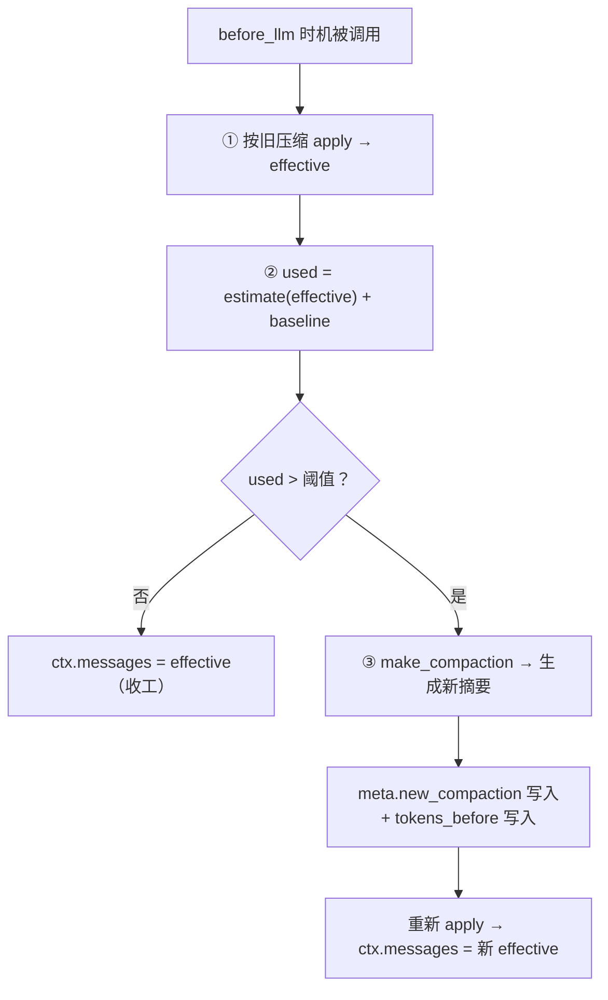

# 插件：compact（上下文压缩）

| 状态 | 最后更新 | 关联代码 | 代码基线 |
|---|---|---|---|
| Stable | 2026-10-16 | `plugins/compact.py` | `515d604` |

> 所属：[插件系统总览](README.md)

## 1. 职责

聊得越来越久时，"要发给模型的上下文"会越堆越大。本插件在每次**调模型之前**
自动检查：接近阈值就把较早的对话**交给模型总结成一段摘要**，之后只发
「摘要 + 最近消息」——上下文瞬间瘦身。

学自 Pi 的 compaction 思路，哲学与事件日志一致：
**原始消息一条不删**（都在 `data.jsonl` 里），压缩只是"追加一条覆盖式记录"。

## 2. 挂载点与触发条件

- 空槽：`before_llm`（空槽机制的第一个"生产级"应用）；
- 总开关：`config.ENABLE_COMPACT`；
- 阈值：`used > CONTEXT_WINDOW × COMPACT_THRESHOLD_RATIO`（默认 1M × 70%）；
- `used` 的构成：**当前有效上下文估算 + 固定基线**（见 §3）。

## 3. 用量估算（`estimate_tokens` 与 `baseline_tokens`）

估算公式（**与前端 `index.html` 的 `estimateTokens` 严格同公式**，保证两边同值）：

- 汉字 ≈ 0.6 token/字；其他字符 ≈ 0.25 token/个；
- 每条消息固定 +4；工具条目额外 +4（它发给模型时会展开成两条协议消息）；
- 工具条目的正文 = `result` + 紧凑格式的 `arguments` JSON；
- `math.ceil` 向上取整（与前端 `Math.ceil` 对齐）。

`baseline_tokens()` = **系统人设 + 工具说明书**的固定窗口占用
（工具说明书按 `all_descriptions()` 的 JSON 估算）——这部分每次请求都在窗口里，
必须计入。注意概念：这是"**窗口占用**"、不是"费用"
（命名刻意避开"开销"一词，防歧义）。

## 4. 核心动作一：`make_compaction(messages, old)`——生成压缩

（也被"手动压缩"接口复用——界面上点「立即压缩」走的就是它）

```
① 消息太少（≤ KEEP_RECENT + 2 条）→ 直接返回 None（不值得压）
② 新边界 new_first = max(旧边界, 总数 - KEEP_RECENT)   ← 只前不进
③ 边界微调：往前退到"用户消息"开头（别把一问一答切成两半）
④ 本次要吸收的 = messages[旧边界 : 新边界]；为空 → None
⑤ 组装摘要素材 =（旧摘要，如果有）+ 本次吸收的对话
     · 工具记录压缩成一行：「（工具 xxx 的结果）前 500 字符」
⑥ 交给 llm.chat 生成新摘要（SUMMARY_PROMPT 规定必须保留：目标/结论/待办/偏好）
⑦ 返回 {"summary", "first_kept_index"}（新边界）
```

三个关键设计：

- **覆盖式全量摘要**：再压时输入 = 旧摘要 + 新增被吸收段 → 输出**一整段**
  新摘要（替换旧的，不套娃、不叠加）;
- **旧边界只前不进**：`max()` 保证保留边界单调前移（历史不会"退回"到
  未压缩状态）；
- **边界落在用户消息上**：保留段从一问一答的"问"开头，模型读起来完整。

## 5. 核心动作二：`apply_compaction(messages, compaction)`——应用压缩

把压缩状态"应用"成真正发给模型的上下文：

```
无压缩状态            → 原样返回
有压缩状态            → [摘要 system 消息] + messages[first_kept_index:]
```

摘要消息采用固定前缀 `【之前的对话摘要】`——`system_prompt` 插件的
"内容比对"逻辑因此不会把它误认成人设。

## 6. 插件本体：`compact_plugin(ctx)` 的完整流程



- 结果通过 `ctx["meta"]["new_compaction"]` 交给引擎 → 引擎产出
  `compacted` 事件 → 前端：记账（`compact` 事件）、显示压缩卡片、
  用量条回落；
- `ctx["messages"]` 被**替换**为 effective——后续引擎用它调模型
  （原始列表对象不动）。

## 7. 与前端 / 存储的联动

| 环节 | 表现 |
|---|---|
| 前端计量条 | 用同一套公式估算当前用量；红色刻度 = 阈值位置 |
| 手动压缩 | 前端按钮 → `POST /api/compact` → 复用 `make_compaction` |
| 记账 | `compacted` 事件 → 前端生成 `compact` 事件（summary + first_kept_index） |
| 回放 | `storage` 把最新一条 `compact` 事件推导为会话的 `compaction` 字段 |
| 展示 | 下次渲染时对话顶部显示"已压缩早期对话"卡片（点开读摘要） |

## 8. 设计决策

- **纯 token 触发**（用户拍板）：不用"条数触发"——条数和用量的关系太不稳定
  （一条巨型工具结果可能顶几十条闲聊）；
- **覆盖式摘要而非滚动叠加**：永远只有"一段摘要"，模型不需要读层层套娃
  的旧摘要；代价是每次都要"旧摘要 + 增量"重写一遍；
- **原始消息不删**：与事件日志哲学一致——压缩是"发送时的投影"，不是
  "数据的删除"；
- **边界只前不进**：防止"压缩后用量算法回退"导致的循环压缩。

## 9. 扩展指南

- **调参数**：`config.py` 的 `COMPACT_THRESHOLD_RATIO`（阈值比例）、
  `KEEP_RECENT_MESSAGES`（保留条数）、`CONTEXT_WINDOW`（窗口大小——
  换模型时务必同步核对）；
- **换摘要求**：`SUMMARY_PROMPT` 在插件文件里，想要不同保留重心（比如
  更强调代码片段）直接改；
- **想加"条数触发"**：在 `compact_plugin` 的阈值判断处加一条
  `或 len(messages) > N` 即可（先跟用户确认要不要）。

## 10. 已知限制与坑

- **估算是粗算**：0.6/0.25 的系数对中英混排是近似——真实 token 数以服务端
  为准；宁可略高估（提前压缩）也别低估（超窗报错）；
- **触发时机在"调模型前"**：如果本轮对话自己就把窗口撑爆（比如一次性
  贴入超长文本），压缩要在**下一轮**才发生（当轮先撞上窗口限制）；
- **摘要素材有截断**：工具记录只取前 500 字符进素材——极端情况下摘要有
  信息损耗（有意取舍：摘要不该和原文一样长）;
- **摘要是模型生成的**：质量依赖模型；`SUMMARY_PROMPT` 规定了保留项，
  但重要细节仍可能丢——原始消息永远在日志里可查；
- **摘要本身花一次模型调用**（`llm.chat`）——压缩不是免费的，只是
  "花小钱省大钱"（省下的是后续每轮的窗口占用）。
