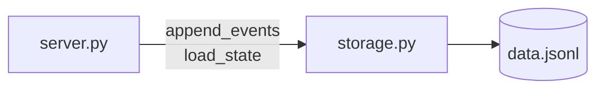
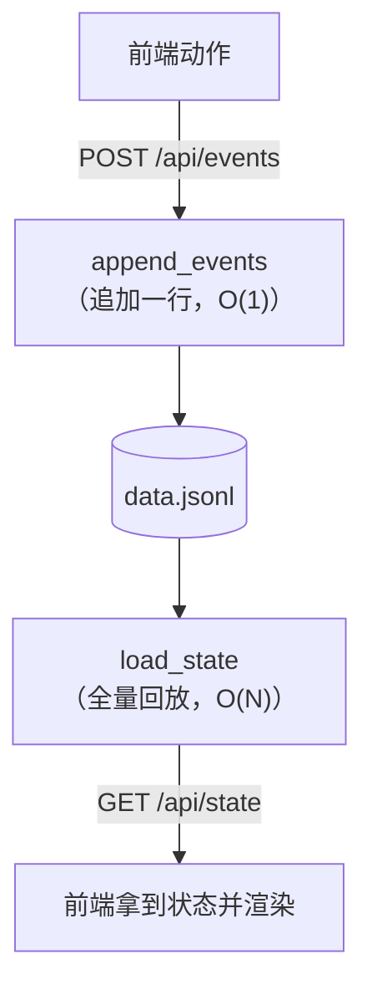

# 模块：storage（存储）

| 状态 | 最后更新 | 关联代码 | 代码基线 |
|---|---|---|---|
| Stable | 2026-10-16 | `storage.py` | `983b38d` |

## 1. 模块职责

数据保管员：围绕事件日志做两件事——

- **写**：`append_events()` 把事件一行行追加到 `data.jsonl`（只追加，从不重写）；
- **读**：`load_state()` 把整个日志**回放**一遍，推导出当前状态。

两个核心思想（学自开源项目 Pi）：

1. **日志是唯一真相**：发生的每件事都落成一条事件，历史完整保留；
2. **状态是投影**：当前状态不直接存储，而是"回放事件"算出来的。

好处：写入快（加一行）、不怕写坏（顶多丢最后一行）、可追溯（想审计、想统计都有据可查）。

## 2. 在系统中的位置

本模块是依赖最"底层"的一个：**只依赖 Python 标准库**（`json` / `datetime` / `pathlib`），
不 import 任何项目内模块。被 `server.py` 使用（两个数据接口 + 启动迁移）。



> 与 `engine.py` 无直接调用关系：engine 的事件流被**前端记账**后经
> server 落进本模块——"谁看谁记"的分工见 [架构总览](../../architecture.md) §5。

## 3. 对外接口

| 接口 | 签名 | 一句话说明 |
|---|---|---|
| `append_events` | `append_events(events)` | 写：把一批事件追加到日志末尾（自动盖时间戳） |
| `load_state` | `load_state() -> dict` | 读：回放全部事件，返回 `{"conversations", "current_id"}` |

### `append_events(events)`

- **参数**：事件字典列表，例如
  `[{"type": "message", "conversation_id": "c1", "role": "user", "content": "你好"}]`；
- **行为**：先做迁移检查（§4.5），再逐条追加：
  - `event.setdefault("timestamp", ...)` —— **后端统一盖时间戳**
    （前端不用操心；已有 timestamp 的不会被覆盖）；
  - `json.dumps(event, ensure_ascii=False)` 一行一条写入。
- **返回**：无（异常直接向上抛，由 server 转成 HTTP 500）。

### `load_state()`

- **参数**：无；
- **返回**：`{"conversations": [...], "current_id": ...}`——
  会话列表（**最新的在最前**，与界面显示顺序一致）+ 当前打开的会话 id；
- **每个会话的结构**：`{id, title, messages, workspace, compaction}`，
  其中 `messages` 是消息时间线（含 role=tool 的工具条目）。

## 4. 内部实现

### 4.1 文件格式（JSONL）

`data.jsonl`——**每行一条 JSON 记录**。用记事本打开长这样（真实例子）：

```json
{"type": "session", "id": "c179...", "title": "新对话", "timestamp": "2026-10-09T15:03:21"}
{"type": "message", "conversation_id": "c179...", "role": "user", "content": "你好", "timestamp": "..."}
{"type": "tool", "conversation_id": "c179...", "name": "list_dir", "arguments": {}, "result": "...", "ok": true, "timestamp": "..."}
{"type": "rename", "id": "c179...", "title": "打个招呼", "timestamp": "..."}
```

### 4.2 回放规则（8 种事件的"状态变化表"）

`load_state()` 顺序遍历所有事件，按 `type` 分发：

| 事件 | 携带字段 | 回放动作 |
|---|---|---|
| `session` | `id`, `title` | 新建会话，**插到列表最前**（初始化 `workspace=None`、`compaction=None`） |
| `message` | `conversation_id`, `role`, `content` | 找到会话，追加消息条目 |
| `tool` | `conversation_id`, `name`, `arguments`, `result`, `ok`, `extra` | 追加 `role=tool` 条目（含附件） |
| `workspace` | `conversation_id`, `path` | `conv.workspace = path`（`null` = 恢复默认） |
| `compact` | `conversation_id`, `summary`, `first_kept_index` | `conv.compaction = {...}`（**最新一条覆盖旧的**） |
| `rename` | `id`, `title` | 更新会话标题 |
| `delete` | `id` | 从列表**过滤掉**（逻辑删除，旧消息行仍在日志里） |
| `switch` | `id` | `current_id = id` |

注意字段名差异：`rename` / `delete` / `switch` 作用于**会话本身**，用 `id`；
其余事件作用于**会话内部**，用 `conversation_id`。

**未知类型直接跳过**——这是事件日志的关键优点：将来加新事件类型，
旧代码不会崩（天然向前兼容）。

### 4.3 写路径与读路径



### 4.4 容错：坏行跳过

`_read_all_events()` 逐行读日志，遇到空行跳过；某行 JSON 解析失败（比如
写入中途断电只写了半行）→ **跳过这一行**，不让整个文件读不出来。
（真实系统还会做校验和、备份恢复，这里从简。）

### 4.5 老数据"搬家"（`_migrate_if_needed`）

从"整份 JSON 文件"（老版 `data.json`）升级到"事件日志"时的一次性迁移：

- **触发条件**：`data.jsonl` 不存在 **且** `data.json` 存在；
- 老文件里的会话按"**老的先写**"的顺序转成 `session` + `message` 事件
  （因为回放时 `session` 会插到列表最前，这样顺序才对得上）；
- 迁移完把老文件改名成 `data.json.bak` 留档（不删，万一想回去看）；
- 改名失败也没关系——日志已存在，下次不会再迁移。

## 5. 交互关系

| 场景 | 调用方 | 接口 | 说明 |
|---|---|---|---|
| 读状态 | server `GET /api/state` | `load_state()` | 启动页面时拉取 |
| 写事件 | server `POST /api/events` | `append_events()` | 前端把每个动作翻译成事件批量提交 |
| 首次运行迁移 | 上面两者的入口处 | `_migrate_if_needed()` | 一次性 |

## 6. 设计决策

- **事件日志 vs 直接存状态快照**（ADR-002）：追加写 O(1) 且恒定耗时
  （实测追加一条约恒定 1ms 量级，与文件大小无关）；代价是读取需要全量回放 O(N)。
  个人项目的数据规模下，"写快 + 不怕坏 + 可追溯"更划算。
- **删除 = 逻辑删除**：`delete` 事件只让回放忽略它——不物理删除行，
  日志永远完整（追加写的哲学不允许"改写历史"）。
- **时间戳后端统一盖**：前端只管提交业务字段，时间戳由存储层补
  （`setdefault` 保证可被显式覆盖，但正常链路没人覆盖）。
- **JSONL 而不是一个大 JSON 数组**：数组需要"读全量 → 改 → 写全量"，
  无法追加；一行一事件才有 O(1) 追加的前提。
- **迁移自动执行**：升级格式不该让用户做任何操作（对齐 Pi 的会话文件升级体验）。

## 7. 扩展指南

### 加一种新事件类型（完整步骤）

1. **前端**：制造并在记账时提交该类型的事件（参照现有事件写法）；
2. **本模块**：在 `load_state()` 里加一个 `elif` 分支，定义它如何改变状态；
3. **文档**：补进 §4.2 的表格和 `data/event-log.md`（规划中）。
   ——旧版本代码遇到新事件会跳过（兼容），但**新的回放逻辑必须上线**才会生效。

### 换个存储位置

`LOG_FILE` / `OLD_JSON_FILE` 两个常量（文件顶部）。

### 数据体积治理

日志只增不减。将来若体积成为问题，方向：定期把早期事件"折叠"成
新的 `session` + 摘要事件（需要设计"快照 + 增量"机制），或将超老日志归档。
当前规模无此需求。

## 8. 已知限制与坑

- **`load_state` 是 O(N) 全量扫描**：每次拉状态都全量回放。对话和工具记录
  多了以后会变慢——目前规模（个人使用）无压力，若将来卡了，可加缓存或快照；
- **坏行静默跳过**：没有告警，数据损坏不易察觉（从简的取舍）；
- **无并发写保护**：假设"单机、单用户、小规模写入"。多进程同时写
  `data.jsonl` 未做防护（当前架构下不会发生）；
- **时间戳精度到秒**：`isoformat(timespec="seconds")`，同秒内多条事件
  顺序靠行序保证；
- **`data.jsonl` 被 `.gitignore` 排除**：它是隐私数据，不进版本库；
  换设备不会带走（这是有意的，不是 bug）；
- **迁移只检查"文件存在与否"**：`data.jsonl` 一旦存在（哪怕是个空文件），
  就不再进行迁移。
