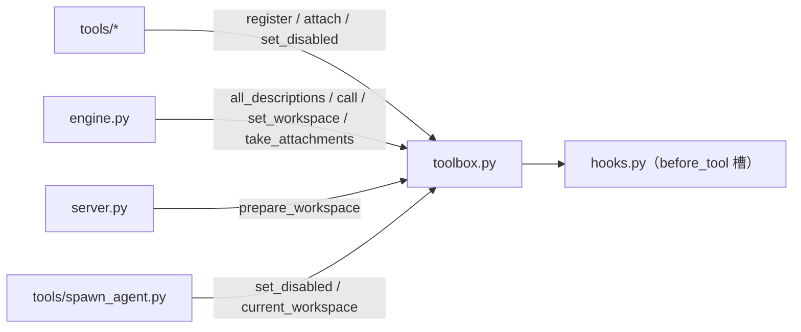

# 模块：toolbox（工具箱）

| 状态 | 最后更新 | 关联代码 | 代码基线 |
|---|---|---|---|
| Stable | 2026-10-16 | `toolbox.py` | `515d604` |

## 1. 模块职责

工具箱是"工具的运行环境 + 基础设施"，一共管五块：

| 块 | 一句话 |
|---|---|
| **注册表** | 所有工具的登记处（`register` / `all_descriptions` / `has`） |
| **调度** | 执行模型点名的工具（`call`，含拦截与异常兜底） |
| **自动加载** | 启动时把 `tools/` 里每个 `.py` 执行一遍（`load_tools`） |
| **工作区管理** | 会话级的"干活范围"（路径锁、黑名单、沙箱补全） |
| **线程本地设施** | 禁用名单（防套娃）+ 附件槽（结构化数据捎带） |

> 先理解"工具"是什么：模型不会读文件，它只能通过"说话"请求干活
> （"帮我调用 read_file，参数是…"）；真正动手的是我们写的 Python 函数。
> 所以一个工具 = **说明书**（发给模型看）+ **执行函数**（模型点名时运行）。
> 注册表的设计目标：无论工具来自本地、MCP 还是 Skill，只要格式统一就能登记——
> 这是给未来预留的"空缺"。

## 2. 在系统中的位置



## 3. 对外接口

### 注册表

| 接口 | 签名 | 说明 |
|---|---|---|
| `register` | `register(description, run, source="builtin")` | 登记一个工具；`description` = 说明书字典，`run` = 执行函数 |
| `all_descriptions` | `all_descriptions() -> list` | 所有工具的说明书（转成 API 两层格式，**过滤禁用名单**） |
| `has` | `has(name) -> bool` | 注册表里有没有这个工具 |
| `load_tools` | `load_tools()` | 自动加载 `tools/` 目录（启动时调一次） |

### 调度

| 接口 | 签名 | 说明 |
|---|---|---|
| `call` | `call(name, arguments) -> str` | 执行工具。三层防护：未注册拒 → 禁用名单拒 → `before_tool` 空槽可拦截；执行异常转成"错误：…"文本 |

### 工作区管理

| 接口 | 签名 | 说明 |
|---|---|---|
| `set_workspace` | `set_workspace(root)` | 记录本线程当前工作区（engine 每次对话开始时调用；`None` = 默认项目目录） |
| `current_workspace` | `current_workspace() -> str / None` | 读取本线程工作区 |
| `dangerous_reason` | `dangerous_reason(path) -> str / None` | 检查目录是否"太宽或太敏感"；返回人话理由或 None |
| `prepare_workspace` | `prepare_workspace(path) -> (真实路径, 是否新建)` | 设置工作区用：合规检查 + 不存在则创建；不合规抛 `ValueError` |

### 线程本地设施

| 接口 | 签名 | 说明 |
|---|---|---|
| `set_disabled` | `set_disabled(names) -> 旧名单` | 设置本线程的工具禁用名单（传集合；空/None = 取消） |
| `disabled_names` | `disabled_names() -> set` | 读取本线程禁用名单 |
| `attach` | `attach(data)` | 给当前这次工具执行捎带结构化数据（附件） |
| `take_attachments` | `take_attachments() -> data / None` | 取走本线程附件并清空（engine 每次工具执行后调用） |

## 4. 内部实现

### 4.1 注册表与"两层包装"

```python
_registry = { 工具名: {"description": ..., "run": ..., "source": ...} }
```

工具文件里写的说明书是"内层格式"（`{"name", "description", "parameters"}`，
简洁好写）；`all_descriptions()` 固定做一次包装成 API 要求的
`{"type": "function", "function": {...}}`——这个转换层也是将来接
MCP / Skill 工具的适配点（远端格式 → 内层格式 → 统一包装）。

**踩坑记录**：工具功能初版就是因为没有这层包装，报错
`tools[0]: missing field type`——API 要的就是两层结构。

### 4.2 线程本地（`_local`）：一个变量，三个用途

服务器是多线程的（每个请求一个线程），三样东西**必须按线程隔离**，否则两
个对话同时进行时会串台：

| 属性 | 用途 | 谁写 | 谁读 |
|---|---|---|---|
| `_local.root` | 当前工作区 | engine（对话开始） | `safe_path`（每次文件操作） |
| `_local.disabled` | 禁用名单 | `spawn_agent`（跑到一半恢复） | `all_descriptions` + `call` |
| `_local.attachments` | 附件 | 工具的 `run`（执行期间） | engine（执行后立刻取走） |

### 4.3 `call()` 的三层防护（顺序很重要）

```
① name 不在注册表        → "错误：没有叫「x」的工具"
② name 在禁用名单        → "错误：工具「x」当前不可用"        （防套娃第二道门）
③ 路过 before_tool 空槽  → 插件把 ctx["blocked"] 设成字符串 → "工具调用被拦截：…"
④ 真正执行（try/except） → 任何异常转成 "错误：工具执行失败：…"
```

设计意图：**所有失败都以"能给模型看的文本"返回**——模型看到错误后
可以自己换策略重试，而不是让整场对话崩掉。

### 4.4 工作区规则（`prepare_workspace` 的完整逻辑）

1. 空路径 → 拒绝；
2. **纯名字补全**：如果输入里没有 `/`、`\`、`:`（就是个名字）→
   自动当作"新建沙箱"，补全成 `<项目目录>/sandbox/<名字>`
   （新对话的默认工作区也走这条路：名字是时间戳，如 `2026-10-16-20-56`）；
3. 黑名单检查（`dangerous_reason`，见下）；
4. 已存在但不是目录 → 拒绝；不存在 → `mkdir(parents=True)` 创建；
5. 返回 `(真实路径, 是否新建)`。

`dangerous_reason` 的拒收名单（精确三条）：

- 盘符根目录（`p.parent == p`，如 `D:\`）；
- 用户主目录**本身**（子目录没问题）；
- `C:/Windows`、`C:/Program Files`、`C:/Program Files (x86)`。

> 这只是"防手滑"兜底。**真正的执行防线**是文件工具里的 `safe_path()`
> （每次操作都重新检查）——设置环节与执行环节双层防护。

### 4.5 禁用名单的用法约定（照抄 spawn_agent）

```python
old = toolbox.set_disabled({"spawn_agent"})
try:
    ...干活（此期间 all_descriptions 和 call 都会拦 spawn_agent）...
finally:
    toolbox.set_disabled(old)   # 必须恢复——用 finally 保证
```

`set_disabled` 返回旧名单、恢复时把它传回去——支持嵌套语义（虽然目前
只有一层使用场景）。

### 4.6 附件的生命周期

```
工具 run() 里 attach(data)
        ↓（同一线程、同一时刻只有一个工具在跑）
engine：result = call(...) → take_attachments() 取走 → 塞进 tool_result 事件
        ↓
前端记账 → 写进事件日志 → 刷新后回放仍在
```

**取走即清空**（`take_attachments` 顺手置 None）——避免上一个工具的附件
粘到下一个工具上。

### 4.7 `load_tools()`：文件即工具

`pkgutil.iter_modules` 遍历 `tools/` 包，跳过 `_` 开头的文件
（`__init__`、`_common` 等内部模块），逐个 `import`——文件末尾那行
`register(...)` 随导入执行，登记完成。**启动时一次性执行**（见 §8 限制）。

## 5. 交互关系

| 场景 | 谁调用 | 哪个接口 |
|---|---|---|
| 对话开始 | `engine.chat_stream` | `set_workspace()` |
| 每轮对话组装工具清单 | `engine.chat_stream` | `all_descriptions()` |
| 模型要求执行工具 | `engine.chat_stream` | `call()` + `take_attachments()` |
| 文件工具解析路径 | `tools/_common.safe_path` | `current_workspace()` + `dangerous_reason()` |
| 用户设置工作区 | `server` → `POST /api/workspace` | `prepare_workspace()` |
| 子代理防套娃 | `tools/spawn_agent.py` | `set_disabled()` / `current_workspace()` |
| 启动加载 | `server.main()` | `load_tools()` |

## 6. 设计决策

- **统一注册表格式**（内层格式 + 统一包装）：本地 / MCP / Skill 工具
  一视同仁——`source` 字段已预留区分来源（`"builtin"` / 将来 `"mcp:…"`）。
- **线程本地而非全局变量**：多线程服务器下防串台，是硬约束不是优化
  （详见架构总览 §4.5）。
- **失败转文本而非抛异常**：`call()` 的契约是"永远返回字符串"——
  错误也是给模型的信息（它可以自我修正），而不是给人类看的异常栈。
- **两道门而非一道**：禁用名单同时作用于"发说明书"和"执行"——
  看不见（不会想用）+ 调不到（硬要也不行），防套娃才可靠。
- **附件机制而非塞返回值**：工具返回字符串（给模型看的），附件是
  "给界面/日志看的"结构化数据——两类消费者分离，互不污染。

## 7. 扩展指南

### 加一个新工具

照抄 `tools/list_dir.py` 的三段结构（说明书 → run → register），
扔进 `tools/` 重启即可——详见 [modules/tools](../tools/README.md)。

### 将来接 MCP / Skill 工具

1. 远端工具拉到后，先转换成本项目的"内层格式"（name/description/parameters）；
2. `register(description, run, source="mcp:服务器名")`——
   `run` 内部把调用转发到 MCP 执行；
3. 其余全链路（说明书包装、调度、禁用名单、附件）**一行都不用改**。

### 加一个新的线程本地设施

仿照禁用名单：`_local.新属性` + 一对 get/set 函数 + 在需要的地方读。
注意想清楚"谁写、谁读、何时清理"。

## 8. 已知限制与坑

- **注册表是进程级全局的**：工具集对所有会话共享（这正是设计目标）；
  需要"按会话隔离工具"时要通过**禁用名单**（线程级）实现——两层粒度不要混；
- **`load_tools` 只在启动时跑一次**：加了新工具文件必须**重启服务**才生效
  （没有热加载）；
- **禁用名单的恢复责任在调用方**：忘了恢复会把工具一直禁着——
  务必用 `try/finally`（照抄 `spawn_agent`）；
- **附件不取会残留**：`attach` 之后必须有人 `take`（engine 正常链路都会取；
  如果工具在 engine 之外被直接调用，注意手动清理）；
- **`prepare_workspace` 的补全规则很朴素**：只按"有没有路径分隔符"判断——
  `C:foo` 这种带冒号的输入会被当成完整路径（Windows 上通常没问题，
  但不是严格解析）。
