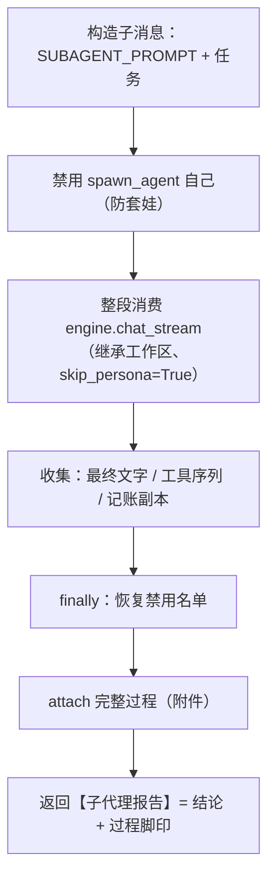

# 工具：spawn_agent（派子代理）

| 状态 | 最后更新 | 关联代码 | 代码基线 |
|---|---|---|---|
| Stable | 2026-10-16 | `tools/spawn_agent.py` | `515d604` |

> 所属：[工具系统总览](README.md)

## 1. 职责

主 agent 派一个**子代理**去独立完成任务：子代理有自己的独立上下文
（看不到主对话）、能自己调用工具，干完只把一份精炼结论带回来。
这是"多 agent"的第一块积木（主从式）——适合"要翻很多文件、但只需要
结论"的调查类任务，把中间过程的上下文消耗隔离在主对话之外。

## 2. 参数

| 参数 | 类型 | 必填 | 说明 |
|---|---|---|---|
| `task` | string | 是 | 给子代理的任务描述——**要自包含**（子代理看不到主对话），写清"干什么、回报什么" |

## 3. 行为流程



关键点：

1. **不造新引擎**：`run()` 里直接 `for event in engine.chat_stream(...)`——
   引擎本来就是"可嵌套消费的生成器"（ADR-007）；
2. **防套娃**：干活期间 `set_disabled({"spawn_agent"})`，结束后 `finally`
   恢复——子代理的工具箱里没有"派子代理"这项；
3. **工作区继承**：`workspace=toolbox.current_workspace()`——
   **必须传当前值**（传 None 会把工作区清成默认项目目录，是踩过的坑）；
4. **跳过项目人设**：`skip_persona=True`——子代理用自己的
   `config.SUBAGENT_PROMPT`（"探子"人设）；
5. **"最终结论"的取法**：循环中每次模型要调工具时，把已攒的文字"封段"；
   循环结束时最后一段文字 = 结论（兜底取最后一个非空文字段）。

## 4. 返回格式与"过程脚印"

返回给主 agent 的字符串：

```
【子代理报告】
（结论正文……）

——（子代理本次调用工具 N 次：read_file×3、list_dir×1）
```

脚印让主 agent（和日志读者）知道"这份结论背后干了多少活"。

## 5. 记账副本与附件（"展开子代理过程"的数据来源）

`run()` 里维护一份 **sub_log**（不进模型，纯给人看）：

| 条目 | 结构 |
|---|---|
| 任务 | `{"role": "user", "content": task}` |
| 过程文字 | `{"role": "assistant", "content": …}`（调工具前的"封段"） |
| 工具调用 | `{"role": "tool", "name", "arguments", "ok", "result"}` |
| 结论 | 最后一条 assistant 段 |

- **大小保险**：`_slim()` 把单条文本截到 3000 字符（防单次子任务撑爆日志）；
- 结束时 `toolbox.attach({"subagent": {"task", "messages", "tool_calls"}})`
  → 随 `tool_result` 事件流向对前端（存进日志）→ 界面工具卡片里
  「展开子代理过程」看的就是它，**失败时也带上**（排查更需要看过程）。

## 6. 设计决策

- **不造新引擎**（ADR-007）：复用 `chat_stream`，主循环/前端/记账全部零改动；
- **完整过程进日志、前端可展开**（ADR-008）：可见性优先，接受日志变大的代价
  （用 `_slim` 截断兜住）；
- **禁止套娃**（拍板决策）：小弟不能再招小弟，防无限递归烧钱——
  实现上是禁用名单，不是硬编码判断（将来想放开就是改一个集合）。

## 7. 扩展指南

- **换/改子代理人设**：`config.py` 的 `SUBAGENT_PROMPT`；
- **整个关掉**：`config.py` 的 `ENABLE_SUBAGENT = False`（工具不注册）；
- **想"角色预设"**（探索者/审查者不同人设）：给 DESCRIPTION 加个
  `role` 参数，按角色选不同 prompt——积木已经就位；
- **想并行派活**：需要并发控制（多线程 + 日志并发写），当前不支持。

## 8. 已知限制与坑

- **token 放大镜**：省的是"主窗口干净"，不是"总花费"——子代理自己多轮跑
  工具也在烧 token，别拿它干小事；
- **执行期间界面只有一行状态**（"子代理出动，正在干活…"）——实时进度
  不往外传（完整过程结束后可展开）；
- **子对话截断不可逆**：超过 3000 字符的单条在日志里是截断版
  （内存里返回给主 agent 的结论不受影响）；
- **出错时子过程不完整**：中途异常（如 API 报错）会丢掉未封段的部分，
  sub_log 里只是"已发生的部分"——仍然 attach（便于排查）；
- **递归防护是"名单"不是"深度计数"**：当前语义 = 子代理完全不能派子代理；
  将来若要"限深 2"，需要把深度放进线程本地传递。
